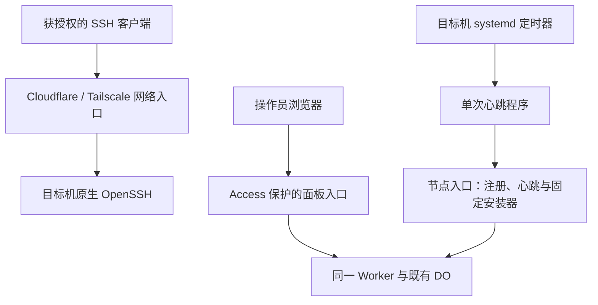

# GhostFleet

**原生 SSH 远控，轻量纳管与节点状态。** Cloudflare Tunnel / Tailscale 把连接送到同一 OpenSSH；薄面板登记节点、签发一次性票据、管理上报凭据，展示最近心跳与本机服务状态。

节点使用 Python 标准库、systemd timer/oneshot 与 journald。SSH 会话由原生服务承担，面板中断不会终止既有 SSH；撤销上报凭据也不会撤销 SSH。

## 架构总览

下图为 `DERIVED` 导航，来源是 [ADR004](docs/adr/004-lightweight-enrollment-presence.md)。实线表示当前组件接口，不表示某个实例已验收。详细边界见[架构导航](docs/ARCHITECTURE.md)。



## 当前交付

**2026-11-18 回执快照：** 公共源码已整合轻量面板、一次性纳管和系统级 reporter。实例工头在[此前三节点回执](https://github.com/youling/ghostfleet/issues/11#issuecomment-6962898014)之后，补交了[第四节点独立纳管、自动心跳与指定路径直连的报告](https://github.com/youling/ghostfleet/issues/11#issuecomment-6977178292)。四节点同时上报只覆盖该次观测窗口，不是实时在线保证，也不证明所有来源或所有 SSH 路径通过。

Cloudflare SSH 仍未验收。原[分层排障回执](https://github.com/youling/ghostfleet/issues/11#issuecomment-6962547549)已确认所选客户端能启动 `cloudflared access ssh`；[北京时间 22:01 的舰队只读复测](https://github.com/youling/ghostfleet/issues/11#issuecomment-6980797500)再次得到 DNS `NXDOMAIN`，同时连接器运行且本机 readiness 为 200。后续应回读权威 DNS、Published Application route 与 Access，再完成新会话正测及拒绝来源/身份负测；NXDOMAIN 本身不能证明缺少 route。连接器运行、出站心跳和另一条 SSH 路径成功，均不能替代这条路径的结果。

生产版本、M2 鉴权与双 origin、M3 恢复测试及 M4 各路径的剩余项统一见 [#11](https://github.com/youling/ghostfleet/issues/11)。源码合并、CI 成功和现场验收分别报告。v1 Python 安装器仍只安装心跳上报功能；POSIX join bootstrap 由面板命令先校验固定摘要，再仅补齐缺失的系统 python3 并启动固定摘要的 Python 安装器，不配置 SSH/provider。Access SSO 和统一远控就绪向导仍是研究项，不在本次实现范围。

**源码与现场分开验收：** [#109](https://github.com/youling/ghostfleet/pull/109) 补齐最小 Linux 系统缺少 Python 的首次引导；[#110](https://github.com/youling/ghostfleet/pull/110) 修复 DynamicUser 下的服务观测与快照文件描述符隔离。两项源码已整合，现役升级与真实 system-unit 验收继续回到原工单。心跳成功可以与服务 `unknown` 同时出现，不能据此认定服务已停止。首次引导的包安装与失败边界见 [ADR005](docs/adr/005-pinned-posix-join-bootstrap.md)。

[产品范围](PRODUCT.md) · [架构](docs/ARCHITECTURE.md) · [传输安装](docs/REMOTE_ACCESS.md) · [面板与心跳部署](docs/PRESENCE.md) · [阶段交付](docs/DELIVERY.md) · [文档目录](docs/README.md)

## 开发与验证

```sh
npm ci --ignore-scripts --no-audit --no-fund
sh test/join-bootstrap.test.sh
npm test
npm run test:python
npm run build
npm run test:live
```

服务端开发需要 Node 22+；节点需要支持 DynamicUser/LoadCredential 的 systemd，首验平台为 Debian 13。首次加入使用哈希固定的 POSIX shell bootstrap：可信 CA bundle、`curl` 或 GNU `wget` 与 `sha256sum` 必须已可用。只有 `/usr/bin/python3` 缺失时，Debian/Ubuntu 使用 apt-get、Fedora/RHEL 系优先 dnf、没有 dnf 时使用 yum 安装 python3 及其必需依赖。已有 Python 低于 3.10 时明确失败，不替换或升级系统 Python；不执行系统升级。节点不需要 npm、Node 或额外 Python 包。构建输出静态页面、哈希固定的 shell bootstrap/Python 安装器与 Worker 配置；部署由实例 owner 配置 origin、Access、应用凭据与既有 DO 绑定。测试不会自动发布。

## English

**Native SSH transport, lightweight enrollment and presence.** Cloudflare Tunnel/Tailscale reach the same OpenSSH service. A thin panel registers nodes, issues reporting-only credentials and shows last-seen plus local service observations. Python standard-library oneshots run under systemd; diagnostics stay in journald. There is no resident command agent, execution API or job queue.

The latest field receipt extends the previous three-node report to a fourth independently enrolled Linux node, with automatic heartbeats and a working direct path from the recorded management client. Four-node reporting is a dated observation, not a live availability guarantee or acceptance of every SSH path. The one-time join flow now uses a hash-pinned POSIX shell bootstrap; trusted CA certificates, curl or GNU wget, and sha256sum are prerequisites. Supported Debian/Ubuntu hosts use apt-get, and Fedora/RHEL-family hosts use dnf or yum, only when system python3 is missing. An existing Python below 3.10 fails without replacement; no system-wide upgrade runs. The shell artifact is verified before execution, and the short code remains a hidden terminal prompt. The Cloudflare SSH path remains unaccepted. A fresh read-only Fleet probe again observed DNS NXDOMAIN while the existing connector was running and its local readiness endpoint returned 200. Read back authoritative DNS, the actual published route and Access configuration before a fresh positive SSH session and denied-source/identity test. NXDOMAIN alone does not prove that a route is absent.

PR #109 integrates the missing-Python bootstrap; PR #110 integrates DynamicUser service observation and snapshot descriptor isolation. Source acceptance does not establish production rollout or the real system-unit canary. Successful heartbeats can contain an unknown service state; that does not prove the service stopped. See [ADR005](docs/adr/005-pinned-posix-join-bootstrap.md) for package effects and failure recovery.

[#11](https://github.com/youling/ghostfleet/issues/11) owns exact production versions and remaining M2/M3/M4 evidence. Source/CI acceptance is separate from deployment and field acceptance. Reporting revocation is not SSH revocation. The v1 installer does not configure SSH or provider networks. Access SSO and unified remote-readiness guidance remain design inputs, not shipped behavior. Follow the commands above and the [deployment runbook](docs/PRESENCE.md); preserve instance-owned origins, credentials and DO identity.

License: AGPL-3.0-only.
