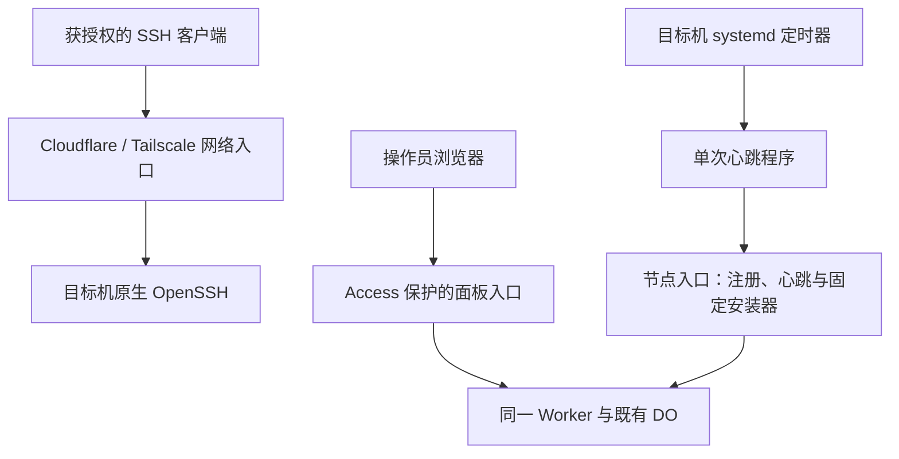

# GhostFleet

**原生 SSH 远控，轻量纳管与节点状态。** Cloudflare Tunnel / Tailscale 把连接送到同一 OpenSSH；薄面板登记节点、签发一次性票据、管理上报凭据，展示最近心跳与本机服务状态。

节点使用 Python 标准库、systemd timer/oneshot 与 journald。SSH 会话由原生服务承担，面板中断不会终止既有 SSH；撤销上报凭据也不会撤销 SSH。

## 架构总览

下图为 `DERIVED` 导航，来源是 [ADR004](docs/adr/004-lightweight-enrollment-presence.md)。实线表示当前组件接口，不表示某个实例已验收。详细边界见[架构导航](docs/ARCHITECTURE.md)。



## 当前交付

**2026-11-18 回执快照：** 公共源码已整合轻量面板、一次性纳管和系统级 reporter。实例工头已报告[三节点独立纳管与连续心跳](https://github.com/youling/ghostfleet/issues/11#issuecomment-6962898014)，并报告[第三节点原生直连可用](https://github.com/youling/ghostfleet/issues/11#issuecomment-6963582377)。这记录当次观测，不是实时在线保证。

Cloudflare SSH 仍未验收。最新[分层排障回执](https://github.com/youling/ghostfleet/issues/11#issuecomment-6962547549)表明：所选客户端已能启动 `cloudflared access ssh`，当前停在 DNS `NXDOMAIN`；后续应回读 DNS、Published Application route 与 Access，再完成新会话正测及拒绝来源/身份负测。连接器运行、出站心跳和另一条 SSH 路径成功，均不能替代这条路径的结果。

生产版本、M2 鉴权与双 origin、M3 恢复测试及 M4 各路径的剩余项统一见 [#11](https://github.com/youling/ghostfleet/issues/11)。源码合并、CI 成功和现场验收分别报告。v1 安装器只安装上报功能；一键加入、Access SSO 和统一远控就绪向导的取舍见[本轮研究](docs/research/ONBOARDING_RECONNAISSANCE_2026-11-18.md)，尚未作为新功能实现。

[产品范围](PRODUCT.md) · [架构](docs/ARCHITECTURE.md) · [传输安装](docs/REMOTE_ACCESS.md) · [面板与心跳部署](docs/PRESENCE.md) · [阶段交付](docs/DELIVERY.md) · [文档目录](docs/README.md)

## 开发与验证

```sh
npm ci --ignore-scripts --no-audit --no-fund
npm test
npm run test:python
npm run build
npm run test:live
```

服务端开发需要 Node 22+；节点需要支持 DynamicUser/LoadCredential 的 systemd，首验平台为 Debian 13。首次加入使用哈希固定的 POSIX shell bootstrap：需要 `curl` 或 `wget` 与 `sha256sum`；若缺少 Python 3 或 CA bundle，会在 Debian/Ubuntu 使用 apt-get、Fedora/RHEL 系使用 dnf 只补齐缺失包，不执行系统升级。节点不需要 npm、Node 或额外 Python 包。构建输出静态页面、哈希固定的 shell bootstrap/Python 安装器与 Worker 配置；部署由实例 owner 配置 origin、Access、应用凭据与既有 DO 绑定。测试不会自动发布。

## English

**Native SSH transport, lightweight enrollment and presence.** Cloudflare Tunnel/Tailscale reach the same OpenSSH service. A thin panel registers nodes, issues reporting-only credentials and shows last-seen plus local service observations. Python standard-library oneshots run under systemd; diagnostics stay in journald. There is no resident command agent, execution API or job queue.

The dated field receipts above report three separately enrolled nodes and a working direct SSH path for the third node. They are observations from that window, not a live availability guarantee. The one-time join flow now uses a hash-pinned POSIX shell bootstrap; on supported Debian/Ubuntu and Fedora/RHEL-family hosts it installs only missing Python/CA prerequisites, without a system-wide upgrade. The shell artifact is verified before execution, and the short code remains a hidden terminal prompt. The Cloudflare SSH path remains unaccepted: client-side cloudflared now starts, but DNS returns NXDOMAIN. Read back DNS, the actual published route and Access configuration, then verify a fresh positive SSH session and the denied-source/identity case.

[#11](https://github.com/youling/ghostfleet/issues/11) owns exact production versions and remaining M2/M3/M4 evidence. Source/CI acceptance is separate from deployment and field acceptance. Reporting revocation is not SSH revocation. The v1 installer does not configure SSH or provider networks. The onboarding/SSO research is a design input, not shipped behavior. Follow the commands above and the [deployment runbook](docs/PRESENCE.md); preserve instance-owned origins, credentials and DO identity.

License: AGPL-3.0-only.
