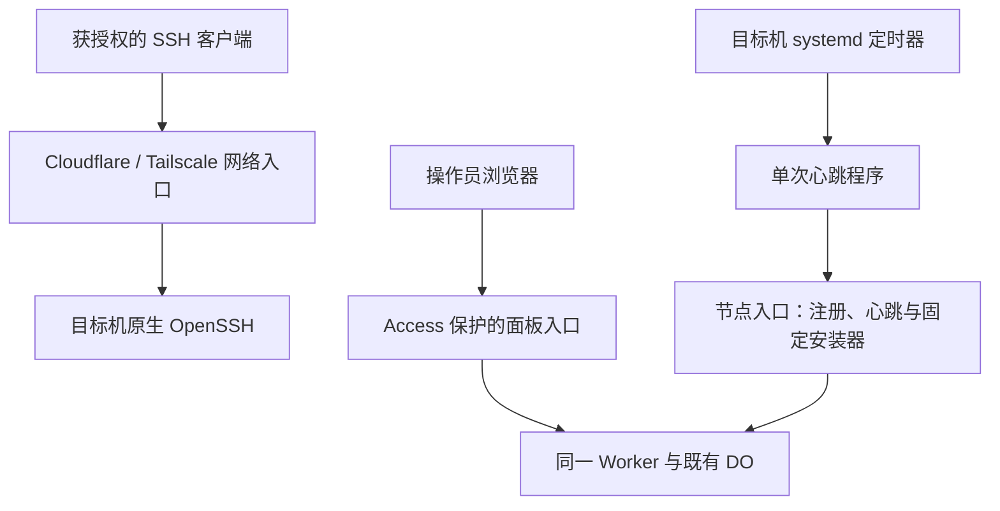

# GhostFleet

**原生 SSH 远控，轻量纳管与节点状态。** Cloudflare Tunnel / Tailscale 把连接送到同一 OpenSSH；薄面板登记节点、签发一次性票据、管理上报凭据，展示最近心跳与本机服务状态。

节点使用 Python 标准库、systemd timer/oneshot 与 journald。SSH 会话由原生服务承担，面板中断不会终止既有 SSH；撤销上报凭据也不会撤销 SSH。

## 架构总览

下图为 `DERIVED` 导航，来源是 [ADR004](docs/adr/004-lightweight-enrollment-presence.md)。实线表示当前组件接口，不表示某个实例已验收。详细边界见[架构导航](docs/ARCHITECTURE.md)。



## 当前候选与恢复入口

**2026-11-28 核对：0.3.0 RC3 已有源码接受和有界隔离验收，尚未正式上线。** 当前候选是 [Draft #143](https://github.com/youling/ghostfleet/pull/143) 的 `4b2a039dc6bce169d8b00ecd34736017df1732db`；[架构评审](https://github.com/youling/ghostfleet/pull/143#pullrequestreview-6091711303)明确区分本轮复验、既有 VM 回执与未完成的现场事项。

| 入口 | 适用范围 |
| --- | --- |
| [阶段交付与版本图](docs/DELIVERY.md) | 当前 RC3、叠加 PR、旧线保留、发行与现场下一步；恢复时先核对 #11 最新回执。 |
| [RC3 操作手册](https://github.com/youling/ghostfleet/blob/4b2a039dc6bce169d8b00ecd34736017df1732db/docs/nextgen/OPERATIONS.md) | 固定候选的统一安装、同 UID 接管、升级、修复、签名 APT 更新与恢复。 |
| [RC3 profile schema](https://github.com/youling/ghostfleet/blob/4b2a039dc6bce169d8b00ecd34736017df1732db/nextgen/install-profile.schema.json) | `ghostfleet-install/v1`；实例值与凭据由 owner 交付。 |
| [主干 v1 运维](docs/PRESENCE.md) | 当前主干保留的旧实现与兼容路径；不把候选目录或安装步骤当成已经合入。 |

统一安装器首发支持 **Debian 13 amd64 + systemd**。同一入口覆盖 GhostFleet 自有组件的首装、接管、覆盖升级、重复执行和修复；TS/CF 当前只读观察，K3s Server/Agent 可由外部管理并观察，获准的专用 K3s Agent 可准备或启动。arm64 reporter 可构建，统一安装器的 arm64 运行未支持。完整边界见[产品范围](PRODUCT.md)和[候选责任图](docs/ARCHITECTURE.md#候选组件责任图)。

实际签名渠道、既有节点迁移、Root、TS 隔离与 K3s 消费分别按原 owner 的现场证据判断。本次实例交付要求包含 TS 和 K3s；公共产品继续支持无 K3s 节点。版本、心跳、网络准入、SSH 认证、Kubernetes RBAC 与 OS 权限分别核验。

### 历史现场证据

[2026-11-18 第四节点回执](https://github.com/youling/ghostfleet/issues/11#issuecomment-6977178292)与[同日 NXDOMAIN 诊断](https://github.com/youling/ghostfleet/issues/11#issuecomment-6980797500)只说明当时的目标、来源和时间窗口，不能作为今天所有 CF 路径或节点的统一结论。现行分项证据回到 [#11](https://github.com/youling/ghostfleet/issues/11)、[#36 传输](https://github.com/youling/ghostfleet/issues/36)与[#64 准入](https://github.com/youling/ghostfleet/issues/64)。[ADR005](docs/adr/005-pinned-posix-join-bootstrap.md)继续解释主干 v1 首次引导；它不替代 RC3 安装手册。

[产品范围](PRODUCT.md) · [架构](docs/ARCHITECTURE.md) · [传输安装](docs/REMOTE_ACCESS.md) · [面板与心跳部署](docs/PRESENCE.md) · [阶段交付](docs/DELIVERY.md) · [文档目录](docs/README.md)

## 主干 v1 开发与验证

```sh
npm ci --ignore-scripts --no-audit --no-fund
sh test/join-bootstrap.test.sh
npm test
npm run test:python
npm run build
npm run test:live
```

服务端开发需要 Node 22+；节点需要支持 DynamicUser/LoadCredential 的 systemd，首验平台为 Debian 13。首次加入使用哈希固定的 POSIX shell bootstrap：可信 CA bundle、`curl` 或 GNU `wget` 与 `sha256sum` 必须已可用。只有 `/usr/bin/python3` 缺失时，Debian/Ubuntu 使用 apt-get、Fedora/RHEL 系优先 dnf、没有 dnf 时使用 yum 安装 python3 及其必需依赖。已有 Python 低于 3.10 时明确失败，不替换或升级系统 Python；不执行系统升级。节点不需要 npm、Node 或额外 Python 包。构建输出静态页面、哈希固定的 shell bootstrap/Python 安装器与 Worker 配置；部署由实例 owner 配置 origin、Access、应用凭据与既有 DO 绑定。测试不会自动发布。

## English

**Native SSH transport, lightweight enrollment and presence.** Cloudflare Tunnel/Tailscale reach the same OpenSSH service. A thin panel registers nodes, issues reporting-only credentials and shows last-seen plus local service observations. Python standard-library oneshots run under systemd; diagnostics stay in journald. There is no resident command agent, execution API or job queue.

As checked on 2026-11-28, the latest candidate is Draft #143 at `4b2a039dc6bce169d8b00ecd34736017df1732db`, version `0.3.0~rc3`. It has bounded source/isolated acceptance, not a completed live release. [DELIVERY](docs/DELIVERY.md) links the exact operations guide, PR lineage and remaining owner-specific evidence. Main still contains the v1 implementation; the development commands above apply to that baseline. Follow the pinned candidate guide when building or testing RC3.

The RC3 installer supports Debian 13 amd64/systemd and its own installation, adoption, upgrade and repair lifecycle. TS/CF modes are read-only observations. External K3s Server/Agent observation and explicitly approved dedicated Agent preparation/start are supported; automatic Server installation and arm64 installer execution are not. Network, OS and cluster authority remain separate. This instance's integrated delivery includes TS and K3s, while the public product retains a non-K3s path.

The fourth-node and NXDOMAIN receipts from 2026-11-18 are historical observations, not current blanket claims about every CF path. See #11, #36 and #64 for current scoped evidence. Preserve the existing node UID, reporting credentials, DO identity and independent native SSH recovery. Reporting revocation is not SSH revocation.

License: AGPL-3.0-only.
