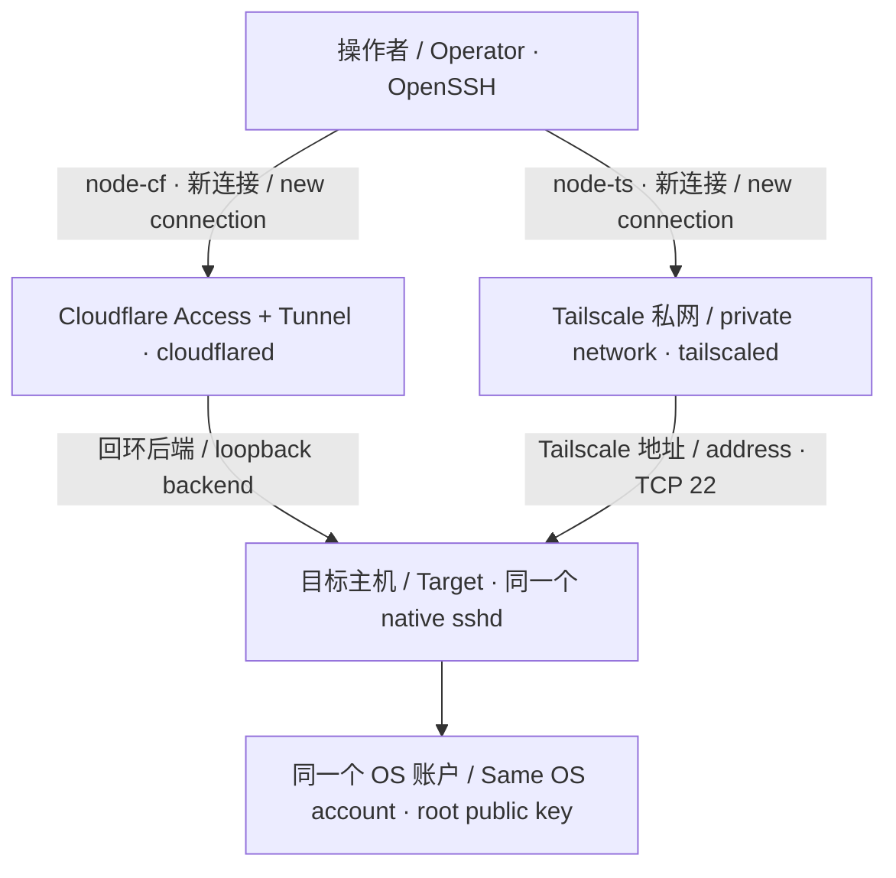

# 架构 / Architecture

| 字段 / Field | 值 / Value |
| --- | --- |
| 文档性质 / Classification | `DERIVED`：由下列产品裁决和候选配置推导，不新增产品权威 / Derived from the decisions and candidate configuration below; not a new product authority |
| `source_pointer` | [Human 产品范围 / product scope](https://github.com/youling/ghostfleet/pull/85#issuecomment-6875500332)；[#11 执行口径 / execution scope](https://github.com/youling/ghostfleet/issues/11#issuecomment-6875523241) |
| 候选入口 / Candidate | [PR #85](https://github.com/youling/ghostfleet/pull/85)；本轮整理时仍为未合并候选，最终 HEAD 待该 PR 的实际审查记录绑定 / Unmerged candidate at this documentation checkpoint; final HEAD must be bound by the PR's actual review record |
| `verified_at` | `2026-11-14`，指来源与文档口径核对日期，不是实例验收日期 / Source and documentation check date, not an instance acceptance date |
| 实例结果 / Instance result | `NOT_RUN`；见 [验收矩阵 / acceptance matrix](ACCEPTANCE.md) |

## 1. 产品边界 / Product boundary

GhostFleet 提供经 Cloudflare Tunnel 和/或 Tailscale 到原生 OpenSSH 的连接配置与操作说明。两路到达同一目标主机的同一个 `sshd`；OpenSSH 完成主机身份校验、账户认证和会话处理，登录后使用该 OS 账户原有权限。当前参考配置选择 `root` 公钥登录，不再增加逐命令审批或命令执行层。

GhostFleet supplies configuration and operating guidance for Cloudflare Tunnel and/or Tailscale access to native OpenSSH. Both paths reach the same `sshd` on the target host. OpenSSH handles host identity, account authentication and sessions; the authenticated OS account retains its normal authority. The reference profile uses public-key authentication as `root`, without an additional command approval or execution layer.

当前范围不包含自建 Node Agent、任务队列、SQLite 命令存储、Helper、逐命令 JIT/HumanGate、自建 SSH 服务、命令解析/过滤/改写、命令审计或自动切换守护进程。连接故障定位使用上游工具和已有日志；不新增主机或命令监控产品。

The scope excludes a custom Node Agent, task queue, SQLite command store, Helper, per-command JIT/HumanGate, custom SSH server, command parsing/filtering/rewriting, command audit, and automatic failover daemon. Troubleshooting uses upstream tools and existing logs; it does not introduce a host or command monitoring product.

## 2. 双路拓扑 / Two-path topology

下图由本页附近的 Mermaid 图源维护，表达 #85 候选的责任关系，所有连接边均为待实例验证的设计关系。相对旧基线，它移除了控制面、Agent 与队列，保留两个上游连接域和同一个 OS/OpenSSH 域；历史映射见 [MIGRATION.md](MIGRATION.md)。

The Mermaid source in this page describes #85's candidate responsibilities. Every connection edge is a design relation awaiting instance verification. Compared with the previous baseline, it removes the control plane, Agent and queue, leaving two upstream connectivity domains and one OS/OpenSSH domain; see [MIGRATION.md](MIGRATION.md) for provenance.

图中箭头表达逻辑 SSH 会话路径。目标端 `cloudflared` 主动连接 Cloudflare，参考后端为 `ssh://127.0.0.1:22`；这不表示目标主机向公网开放 SSH 入站端口。Tailscale 路径使用目标的私网地址直达原生 `sshd`，保持 Tailscale SSH 关闭。两路的网络准入各由对应上游策略控制，账户认证仍由同一个 OpenSSH 完成。部署步骤见 [REMOTE_ACCESS.md](REMOTE_ACCESS.md)。

Arrows describe the logical SSH session path. Target-side `cloudflared` connects outbound to Cloudflare, with `ssh://127.0.0.1:22` as the reference backend; the diagram does not require a public inbound SSH port. The Tailscale path reaches native `sshd` at the target's private address, with Tailscale SSH disabled. Each upstream controls admission to its own path, while the same OpenSSH server authenticates the OS account. See [REMOTE_ACCESS.md](REMOTE_ACCESS.md) for setup.

## 3. 责任与身份 / Responsibilities and identity

| 责任 / Responsibility | 现有承担者 / Existing owner |
| --- | --- |
| CF 路径连接、准入 / CF connectivity and admission | Cloudflare Tunnel、Access 与两端所需 `cloudflared` / Cloudflare Tunnel, Access and the required client/target `cloudflared` |
| TS 私网连接、准入 / TS connectivity and admission | Tailscale 与其网络策略 / Tailscale and its network policy |
| 主机密钥、账户公钥、shell/exec/SFTP / Host keys, account keys, shell/exec/SFTP | 原生 OpenSSH 与 OS 账户配置 / Native OpenSSH and OS account configuration |
| 上游服务进程恢复 / Upstream service recovery | OS 服务管理器；参考 Linux 使用 systemd / OS service manager; systemd on the reference Linux setup |
| 故障证据 / Diagnostic evidence | 上游服务状态、原生日志与实例 owner 的验收记录 / Upstream service state, native logs and the instance owner's acceptance record |

同一节点的 `node-cf`、`node-ts` 应使用同一个、已带外核验的主机密钥身份；它们可以共享该节点的 `HostKeyAlias`。不同节点必须使用不同的 `HostKeyAlias`。示例中的 `ghostfleet-node` 是单节点占位值，不能复制为全机群共用身份。连接路径、服务身份和 OS 账户是不同概念，网络准入成功不等于 SSH 账户认证成功。

For one node, `node-cf` and `node-ts` use the same out-of-band-verified host identity and may share that node's `HostKeyAlias`. Different nodes require distinct aliases. The example `ghostfleet-node` is a single-node placeholder, not a fleet-wide identity. A connection path, server identity and OS account are separate concepts; network admission does not prove SSH account authentication.

## 4. 故障域与恢复 / Failure domains and recovery

两路提供可人工选择的连接入口，并不构成两台独立系统。只有路径独有故障才可能通过另一入口绕开；是否可用须由新会话实测。

The two paths provide manually selectable connection entries, not two independent systems. An alternate entry may bypass a path-specific failure; a fresh session must establish whether it actually works.

| 故障域 / Failure domain | 两路关系 / Relationship between paths |
| --- | --- |
| 目标主机、电源、内核 / Target host, power, kernel | 共用；目标不可用时两路都不能提供该主机会话 / Shared; neither path can provide a session on an unavailable host |
| `sshd`、PAM、账户与服务端配置 / `sshd`, PAM, account and server configuration | 共用；换入口不修复账户或服务配置错误 / Shared; changing the path does not repair account or server configuration |
| 管理公钥及主机身份 / Administrator key and host identity | 参考配置共用；凭据问题不能靠换入口绕过 / Shared in the reference profile; an alternate path does not bypass credential problems |
| 目标 LAN、路由器、出口与 DNS 依赖 / Target LAN, router, uplink and DNS dependencies | 可能共用；两路不保证独立网络故障域 / May be shared; the paths do not guarantee independent network failure domains |
| Cloudflare 路径或 Tailscale 路径特有故障 / Cloudflare- or Tailscale-specific failure | 另一入口可能可用，取决于其依赖与准入策略 / The other entry may work, subject to its dependencies and admission policy |

已建立的 TCP/SSH 会话不会在两个别名之间迁移。连接中断后，操作者选择另一别名建立新会话，并先确认旧操作结果；不知道是否完成的命令不得自动重放。恢复上游进程依赖原有服务管理器，不新增全局任务恢复队列。原生 SSH 登录与服务日志也不等于完整命令审计记录。

An established TCP/SSH session does not migrate between aliases. After an interruption, the operator selects an alias for a new session and first establishes the outcome of prior work; commands with an unknown outcome must not be replayed automatically. Existing service management recovers upstream processes, without a global task recovery queue. Native SSH login and service logs are not a complete command audit trail.

## 5. 文档与证据边界 / Documentation and evidence boundary

本图和责任表是 `DERIVED` 说明，不是已部署清单或可用性证明。静态配置检查、CI 和文档审查不能证明真实登录、PAM、`authorized_keys` 选项、`ForceCommand`、shell/exec/SFTP、撤销或断网恢复。实例 owner 按 [ACCEPTANCE.md](ACCEPTANCE.md) 记录实际结果；历史实现和旧报告的保留方式见 [MIGRATION.md](MIGRATION.md)。

This diagram and responsibility table are `DERIVED` descriptions, not a deployment inventory or availability proof. Static configuration checks, CI and documentation review do not establish live login, PAM, `authorized_keys` options, `ForceCommand`, shell/exec/SFTP, revocation or recovery. The instance owner records observed results in [ACCEPTANCE.md](ACCEPTANCE.md). [MIGRATION.md](MIGRATION.md) preserves the provenance of prior implementations and research.
