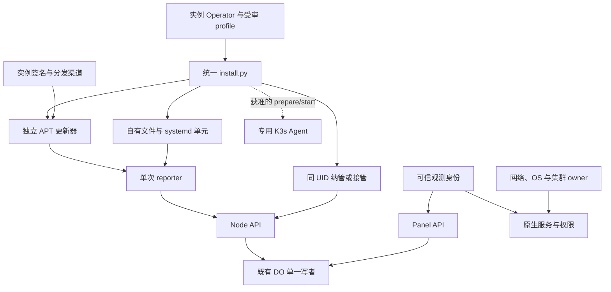

# 架构 / Architecture

本页是 `DERIVED` 架构导航，核对日期 **2026-11-28**。主干 v1 语义归 [ADR004](adr/004-lightweight-enrollment-presence.md)，0.3.0 候选归 [#11 当前合同](https://github.com/youling/ghostfleet/issues/11#issuecomment-7218722415)与[固定 RC3 架构](https://github.com/youling/ghostfleet/blob/4b2a039dc6bce169d8b00ecd34736017df1732db/docs/nextgen/ARCHITECTURE.md)。两者分别说明，具体部署与分项验收回到 #11 原回执。旧图和历史实例安排保留在 Git/ADR 历史，不从图推定当前权限或上线。

## 主干 v1 责任域

三个责任域互不冒充：

| 域 | 所有的事实与动作 | 不负责 |
|---|---|---|
| 原生传输 | CF/TS 网络准入、OpenSSH 主机/用户认证、正常 shell/exec/SFTP | 心跳控制面、逐命令审批 |
| 轻量面板与 API | 稳定 node_uid、一次性票据、上报凭据、最后心跳投影 | provider mint、SSH 管理私钥、远程执行 |
| Linux reporter | systemd 定时调度、读取固定 unit 状态、HTTPS 上报、journald | 常驻 Agent、任务队列、全量日志上传 |

一个参考 Worker 处理两个生产 HTTPS origin；同一个既有 DO 保存节点/票据。Panel 由部署方全站 Access 加应用角色保护；node origin 只暴露机器路由和哈希固定安装器。具体拓扑、凭据与真实证据留私有 owner。边界图与失败/恢复语义见 ADR004；部署动作见 [PRESENCE](PRESENCE.md)。

旧节点的 `ACTIVE`、资产字段与 node_uid 不被心跳覆盖。首次心跳只改变派生 presence。凭据撤销仅拒绝 reporting，原生 SSH 权限另行管理。网络/SSH/本机进程/心跳分别验收；一条路径成功不代表双路通过。

交付依赖与阶段图见 [DELIVERY](DELIVERY.md)：源码整合、私有发布包/双 origin、首节点系统级安装与浏览器首用、第二节点复制分别交付；CF 原生传输验收可按原授权独立推进。该图只表达依赖，当前完成状态回到 #11；ADR004 继续持有组件边界。

### 状态与证据怎么读

| 展示或回执 | 能证明什么 | 还需什么证据 |
| --- | --- | --- |
| 节点已登记 | 稳定 `node_uid` 已分配 | 安装、上报与远控各自的结果 |
| 心跳在线 | 该节点凭据的近期出站上报已收到 | 从指定管理端到目标的入站连接 |
| 本机服务 active | 对应 systemd manager 中的 unit 状态 | provider 路由、网络准入与 SSH 认证 |
| 本机服务 not_found | 所查询的 system manager 未找到该 unit | 核对 unit 名称与实际 manager；用户服务不能由系统服务查询代替 |
| 本机服务 unknown | 本轮未取得可解释的服务查询结果 | 核对管理器范围、D-Bus 和查询错误；不据此判断服务停止或节点离线 |
| 某条 SSH 路径已验证 | 所记录客户端、账户、主机身份与时间窗口内的新会话通过 | 其它路径、拒绝来源及恢复范围各自的结果 |

这些是现有证据的不同含义，不新增状态数据库。具体实例回执仍归 #11。源码实现见 [Worker](../src/adapters/cloudflare/worker.js)、[心跳模型](../src/control-plane/presence.js)和 [reporter](../scripts/heartbeat.py)。

### 纳管体验的下一步

[2026-11-18 研究与提案整合](research/ONBOARDING_RECONNAISSANCE_2026-11-18.md)建议：复用现有 Access 会话、减少票据/UID 搬运，并把原生 SSH 准备与新会话验证放进同一可恢复流程。它是后续实现输入；现有组件图仍只描绘 ADR004 已实现的边界，尚不包含 SSO、自动公钥写入或端点上报。

## English

ADR004 is the semantic owner; this page is derived architecture documentation for the integrated main, not a per-instance release ledger. Production versions, node acceptance and remaining gates are recorded in #11. Native network/SSH transport, panel/API state and Linux reporting are separate domains. One reference Worker uses two HTTPS origins and one existing DO. Instance-owned Access and Operator/Read authorization protect the panel; the machine origin exposes only authenticated claim/heartbeat plus the pinned public installer.

The reporter is scheduled, one-shot, and command-free. A service result of `not_found` refers to the queried system manager; a user-only unit can still be running elsewhere. `unknown` means that this observation did not produce an interpretable service result. Check manager scope, D-Bus and query errors; neither result alone proves the service stopped or the node is offline. A heartbeat can succeed while a service observation is unknown. Existing node_uid, asset fields and lifecycle are retained. Heartbeat freshness does not promote ACTIVE or prove incoming SSH connectivity. Reporting revocation does not revoke SSH. See ADR004 for the diagram and bounded failure/recovery semantics, PRESENCE for deployment, and REMOTE_ACCESS for native transport setup.

[DELIVERY](DELIVERY.md) diagrams the delivery dependencies: source integration, instance package/two origins, first-node system installation and browser first use, then second-node replication. Native CF acceptance can proceed independently under existing authority. The diagram describes dependencies; #11 owns current status and ADR004 continues to own component boundaries.

## 候选组件责任图

**阅读任务：RC3 的安装、更新、状态和外部权限分别由谁承担。** 图源在本节，来源为 exact `4b2a039dc6bce169d8b00ecd34736017df1732db` 的 [install.py](https://github.com/youling/ghostfleet/blob/4b2a039dc6bce169d8b00ecd34736017df1732db/nextgen/host/install.py)、[操作手册](https://github.com/youling/ghostfleet/blob/4b2a039dc6bce169d8b00ecd34736017df1732db/docs/nextgen/OPERATIONS.md)和[架构评审](https://github.com/youling/ghostfleet/pull/143#pullrequestreview-6091711303)。实线为候选代码接口，虚线为明确获准的可选能力；两种线都不表示已在生产部署。

相对 v1，本阶段增加统一安装入口、版本化 profile、独立签名更新与可选 Agent 接缝；既有 `node_uid`、reporting 凭据和 DO 存储身份保持连续。周期更新只更新 reporter，bootstrap/profile 与信任变化仍经各自受信交付。安装器的 TS/CF `observe` 不安装 Provider，`external` K3s 不接管第三方服务，专用 Agent 的本地准备也不自行签发入群权限。

| 边界 | canonical owner 与实际接口 |
| --- | --- |
| 节点事实 | 既有 DO 拥有注册、邀请、撤销及有界观察；reporter 只写自身证据。 |
| 安装与发行 | 受审 Git 提交生成平台制品；独立实例 signer 授权渠道；安装器只更新有归属的文件，原生 APT 校验信任链。 |
| 原生管理 | TS/CF 准入、OpenSSH 认证、OS 权限和 Kubernetes RBAC 各归可信 owner；Fleet 标签、版本、心跳或 Node Ready 不授予操作权。 |
| 多 Controller | 多个独立授权主体各自持有凭据、目标范围和恢复路径；普通 Runner 不继承宿主的管理权，同一独占任务按现有 fencing/UNKNOWN 对账。 |
| 私有消费者 | 私有 DCR、Root 委派及真实工作负载消费由原实例 Work 验收；公共仓只提供可验证的事实与原生接缝。 |

按[现行 TS-first 裁决](https://github.com/youling/ghostfleet/issues/11#issuecomment-7213963670)，仅对已确认未派发的传输不可达选择获准备用路径；鉴权拒绝、身份冲突保持拒绝，UNKNOWN 先对账。#64 的隔离缺口只阻断依赖该隔离的动作，不成为所有本地实验和发行准备的统一前置。

### 历史目标与当前交付

[ADR007](adr/007-fully-managed-lower-node-enrollment.md)保留全自动纳管目标及早期实例安排。[旧 FULLY_MANAGED 图](https://github.com/youling/ghostfleet/blob/d24138597fea41c74400f741ddd9634b40d8a7e8/docs/ARCHITECTURE.md)是目标流程，不是已实现的所有者或生产状态。其单 Controller、特定 VPS 首验和排除 VM 的安排已由后发[多 Controller](https://github.com/youling/ghostfleet/issues/11#issuecomment-7213963670)与[既有节点迁移](https://github.com/youling/ghostfleet/issues/11#issuecomment-7211586141)裁决限定为历史范围。

当前安装器支持 Debian 13 amd64/systemd；TS/CF 只读观察、K3s Server 外部管理、专用 Agent 有界准备/启动。Root、网络隔离、实际消费者和正式签名仍分别待现场证据；[版本与交付图](DELIVERY.md)列出原工作线。原生 SSH 救援独立于面板和 K3s。

### Candidate summary

The RC3 diagram is derived from the pinned candidate and review, checked on 2026-11-28. Solid edges describe candidate interfaces, not production deployment; the optional edge requires explicit native Agent approval. The installer owns its files and profile, signed APT owns reporter delivery, and the existing DO remains the registration/evidence writer. TS/CF observation does not configure providers, and external K3s observation does not install a Server. Network, OS, cluster and private consumer authority remain separate.

Multiple independently authorized Controllers supersede the old universal reading of a single-Controller instance. Retain the ADR007 historical source and follow current #11 decisions for existing-node migration and isolated VM work. Source and isolated acceptance do not establish a live Root/TS/K3s release.
