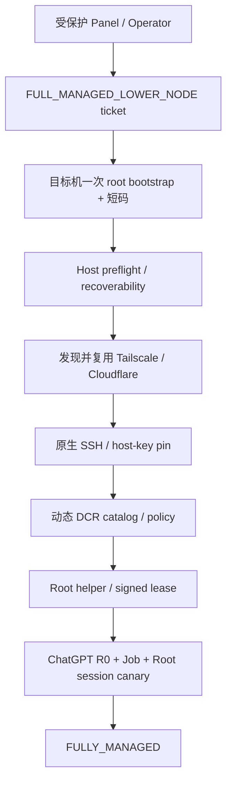

# 架构 / Architecture

当前语义由 [ADR004](adr/004-lightweight-enrollment-presence.md) 与 [#11](https://github.com/youling/ghostfleet/issues/11) 持有。本页是当前集成主干的 DERIVED 架构导航，说明组件职责、接口与边界；它不是实例发布状态库，也不代替生产验收。具体生产版本、节点验收与剩余门禁以 #11 回执为准。原 transport-only 图和旧控制平台保留在 Git 历史中。

## 中文

三个责任域互不冒充：

| 域 | 所有的事实与动作 | 不负责 |
|---|---|---|
| 原生传输 | CF/TS 网络准入、OpenSSH 主机/用户认证、正常 shell/exec/SFTP | 心跳控制面、逐命令审批 |
| 轻量面板与 API | 稳定 node_uid、一次性票据、上报凭据、最后心跳投影 | provider mint、SSH 管理私钥、远程执行 |
| Linux reporter | systemd 定时调度、读取固定 unit 状态、HTTPS 上报、journald | 常驻 Agent、任务队列、全量日志上传 |

一个参考 Worker 处理两个生产 HTTPS origin；同一个既有 DO 保存节点/票据。Panel 由部署方全站 Access 加应用角色保护；node origin 只暴露机器路由和哈希固定安装器。具体拓扑、凭据与真实证据留私有 owner。边界图与失败/恢复语义见 ADR004；部署动作见 [PRESENCE](PRESENCE.md)。

旧节点的 `ACTIVE`、资产字段与 node_uid 不被心跳覆盖。首次心跳只改变派生 presence。凭据撤销仅拒绝 reporting，原生 SSH 权限另行管理。网络/SSH/本机进程/心跳分别验收；一条路径成功不代表双路通过。

交付依赖与阶段图见 [DELIVERY](DELIVERY.md)：源码整合、私有发布包/双 origin、首节点系统级安装与浏览器首用、第二节点复制分别交付；CF 原生传输验收可按原授权独立推进。该图只表达依赖，当前完成状态回到 #11；ADR004 继续持有组件边界。

### 状态与证据怎么读

| 展示或回执 | 能证明什么 | 还需什么证据 |
| --- | --- | --- |
| 节点已登记 | 稳定 `node_uid` 已分配 | 安装、上报与远控各自的结果 |
| 心跳在线 | 该节点凭据的近期出站上报已收到 | 从指定管理端到目标的入站连接 |
| 本机服务 active | 对应 systemd manager 中的 unit 状态 | provider 路由、网络准入与 SSH 认证 |
| 本机服务 not_found | 所查询的 system manager 未找到该 unit | 核对 unit 名称与实际 manager；用户服务不能由系统服务查询代替 |
| 本机服务 unknown | 本轮未取得可解释的服务查询结果 | 核对管理器范围、D-Bus 和查询错误；不据此判断服务停止或节点离线 |
| 某条 SSH 路径已验证 | 所记录客户端、账户、主机身份与时间窗口内的新会话通过 | 其它路径、拒绝来源及恢复范围各自的结果 |

这些是现有证据的不同含义，不新增状态数据库。具体实例回执仍归 #11。源码实现见 [Worker](../src/adapters/cloudflare/worker.js)、[心跳模型](../src/control-plane/presence.js)和 [reporter](../scripts/heartbeat.py)。

### 纳管体验的下一步

[2026-11-18 研究与提案整合](research/ONBOARDING_RECONNAISSANCE_2026-11-18.md)建议：复用现有 Access 会话、减少票据/UID 搬运，并把原生 SSH 准备与新会话验证放进同一可恢复流程。它是后续实现输入；现有组件图仍只描绘 ADR004 已实现的边界，尚不包含 SSO、自动公钥写入或端点上报。

## English

ADR004 is the semantic owner; this page is derived architecture documentation for the integrated main, not a per-instance release ledger. Production versions, node acceptance and remaining gates are recorded in #11. Native network/SSH transport, panel/API state and Linux reporting are separate domains. One reference Worker uses two HTTPS origins and one existing DO. Instance-owned Access and Operator/Read authorization protect the panel; the machine origin exposes only authenticated claim/heartbeat plus the pinned public installer.

The reporter is scheduled, one-shot, and command-free. A service result of `not_found` refers to the queried system manager; a user-only unit can still be running elsewhere. `unknown` means that this observation did not produce an interpretable service result. Check manager scope, D-Bus and query errors; neither result alone proves the service stopped or the node is offline. A heartbeat can succeed while a service observation is unknown. Existing node_uid, asset fields and lifecycle are retained. Heartbeat freshness does not promote ACTIVE or prove incoming SSH connectivity. Reporting revocation does not revoke SSH. See ADR004 for the diagram and bounded failure/recovery semantics, PRESENCE for deployment, and REMOTE_ACCESS for native transport setup.

[DELIVERY](DELIVERY.md) diagrams the delivery dependencies: source integration, instance package/two origins, first-node system installation and browser first use, then second-node replication. Native CF acceptance can proceed independently under existing authority. The diagram describes dependencies; #11 owns current status and ADR004 continues to own component boundaries.

## 正式版扩展：全自动下位机纳管 / Full-managed lower-node provisioning

ADR004 的 reporter-only 流程继续作为独立子能力，不再代表完整远控纳管。正式版增加一个受 Owner profile 授权的 provisioning orchestration：Panel/既有 DO 签发一次性 ticket；目标机运行固定摘要 root bootstrap；私有 Host/DCR owner 在同一 Node UID 下完成原生 SSH、Provider 复用、DCR policy、Root helper/lease 和真实 ChatGPT receipt。

图中每一步均绑定同一个不可变 `node_uid` 与幂等 operation receipt；失败留在可恢复的阶段，不创建第二身份。Provider 状态、主机服务、SSH 认证、DCR 权限和 Root session 分开显示，不用一个心跳绿灯代替全部验收。

| 所有者 | 正式版职责 |
|---|---|
| GhostFleet 公共面板 | Operator profile、ticket/短码、固定摘要 bootstrap、阶段状态、失败原因和同 UID repair/resume |
| Tailscale / Cloudflare | 原生网络身份、设备/隧道状态、服务发现、Edge/Connector 事实；已有资源先复用 |
| 私有 Fleet/DCR | Provider UID 映射、动态 transport locator、Host Key pin、能力策略、Root helper/lease 与 actor scope |
| Host bootstrap | 一次授权下完成本机预检与受限安装；不暴露长期 root private key |
| ChatGPT | 通过现有 DCR 工具完成真实 R0、Job、root-probe 和受委托 Root session |

**角色合同：TP 唯一 Controller；搬瓦工 Canary、JG、NAS、WCX、SYJ 与未来国内生产力服务器全部为 Managed 下位机。** Managed→Controller 与 Managed→Managed 的新管理连接不因纳管自动开放。

首个全新纳管验收目标为真实搬瓦工 VPS，不使用虚拟机；通过后再按单节点 canary → 小批次 → 全量 rollout 纳管国内生产力服务器。新节点不得要求逐台修改 Worker 源码或 Wrangler VPC 静态 binding；若当前 transport 仍有静态 binding 瓶颈，必须在 FULLY_MANAGED 发布前解决动态 locator/route 消费，不得把手工补配置称为全自动。

详见 [ADR007](adr/007-fully-managed-lower-node-enrollment.md)。该图描述正式版目标架构，不代表当前全流程已经实现或真实 Canary 已通过；实时证据仍归 #11/#300。
