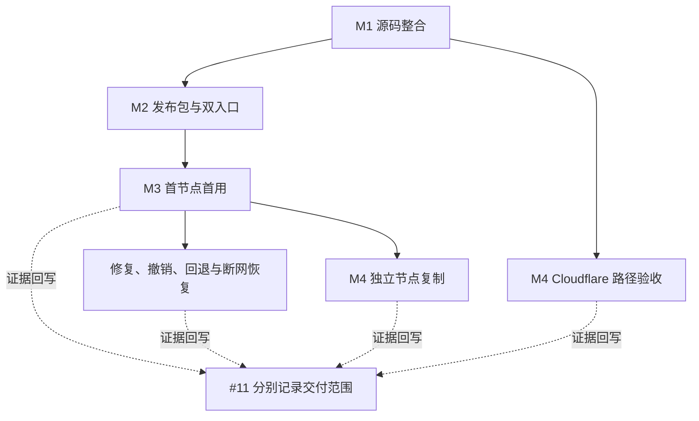

# 阶段交付 / Staged delivery

| 字段 / Field | 值 / Value |
| --- | --- |
| 文档性质 / Classification | `DERIVED`：交付条件与依赖导航，不是状态数据库 / Delivery criteria and dependency navigation, not a status database |
| `source_pointer` | [#11 当前目标、裁决与回执 / Current goal, decisions and receipts](https://github.com/youling/ghostfleet/issues/11)；[ADR004](adr/004-lightweight-enrollment-presence.md) |
| 文档核对日期 / Documentation checked | `2026-11-18`；不表示已经部署 / Does not establish deployment |

## 1. 范围与用法 / Scope and use

交付当前最小产品：原生 SSH、薄面板、一次性注册和 systemd/journald 心跳。当前进度、责任人、精确候选与接受结论留在 #11 及其引用的原工单、PR 和实例回执。本页不复制动态状态，不新开父工单。沿既有授权和责任线执行；源码整合不自动扩大生产、凭据或系统级安装权限。

Deliver the current minimal product: native SSH, a thin panel, one-time enrollment and systemd/journald presence. Current progress, owners, exact revisions and acceptance remain in #11 and its linked original work, PRs and instance receipts. This page creates no parallel status register or parent work item. Use existing authority and ownership; source integration does not expand production, credential or system-installation authority.

每阶段完成即可交付其实际覆盖的能力。只解决具体缺口，不新增固定观察期、框架、数据库或命令执行面。已经接受的证据在版本和范围仍适用时复用；有变更就核对变更影响。真实节点、域名、provider 定位符、凭据及原始日志留实例 owner，公开记录只保留脱敏摘要。

Deliver each stage's proven capability when complete. Resolve concrete gaps without adding a fixed observation period, framework, database or command plane. Reuse accepted evidence while its revision and scope remain applicable; assess the actual effect of later changes. Keep real node/domain/provider locators, credentials and raw logs with the instance owner; public records contain sanitized summaries only.

## 2. 交付条件 / Delivery criteria

| 阶段 / Stage | 交付物 / Deliverable | 完成证据 / Completion evidence |
| --- | --- | --- |
| M1 源码整合 / Source integration | 在既有候选线整合已审实现，修正文档，形成实际发布源码 / Integrate the reviewed implementation on the existing candidate line, reconcile docs and identify release source | 最终 HEAD/tree、适用审查、对应 CI、构建结果与发布物摘要；旧命令面未恢复；普通合并按当前委托 / Final HEAD/tree, applicable review, matching CI, build and artifact digests; no restored command plane; ordinary merge under current delegation |
| M2 发布包与 origin / Release package and origins | 一个 Worker、既有 DO 身份、panel/node 两个 HTTPS origin、实例覆盖及回退点 / One Worker, retained DO identity, two HTTPS origins, instance overlay and rollback reference | 按 PRESENCE 构建与 dry-run；实际发布后回读版本/路由；panel 的 Access、Operator/Read 与 node origin 边界正负测；公开安装器实际字节摘要匹配 / Build and dry-run per PRESENCE; after deployment read back version/routes, verify panel Access/Operator/Read and node-origin boundaries, and match the served installer digest |
| M3 首节点可用 / First node usable | 一个已有原生传输的授权节点完成实际系统级安装和受保护浏览器首用 / Actual system installation and protected-browser first use on one authorized node with existing native transport | **核心首用验收**：受保护浏览器签发票据→固定哈希安装/同节点更新→系统级 DynamicUser/LoadCredential timer/oneshot 自动运行→连续真实 heartbeat，journald 无配置权限错误，并确认既有 SSH 保留。repair、revoke、回退及网络中断恢复作为独立韧性验收，不由一次成功心跳推定通过 / **Core first-use acceptance**: protected-browser ticket → pinned install/same-node update → system DynamicUser/LoadCredential timer/oneshot runs automatically → repeated real heartbeats, no credential-permission error in journald, and existing SSH preserved. Repair, revoke, rollback and network-outage recovery are separate resilience checks; a successful heartbeat does not imply they passed |
| M4 可复制与传输补齐 / Replication and transport completion | 相同发布物部署第二节点；CF 路径独立完成 / Reuse the same release on a second node; complete CF transport separately | 第二节点身份/凭据/服务/回退分别有证据；CF 按 ACCEPTANCE 单独验收，只有两路均通过才声明双路 / Separate second-node identity, credentials, service and rollback evidence; validate CF through ACCEPTANCE and claim dual-path access only when both paths pass |

M2 的 dry-run 是“发布包已准备”，真实版本和鉴权回读才支持“面板已发布”。M3 的核心交付是“首节点可用”：必须有真实系统级自动心跳与原生 SSH 保持证据；repair/revoke/rollback/网络中断恢复是独立韧性验收，须单独留证，不能由 happy path 代替。M3 首节点验收不证明第二节点或双路远控。M4 的第二节点复制与 CF 接线可以并行，CF 也可在源码确定后按原授权提前推进。CF 未完成时保留其未验收状态，不撤销已经成立的单路或面板交付。

M2 dry-run supports “release package prepared”; actual version and authorization readback support “panel released.” M3's core delivery is “first node usable”: require real systemd-triggered heartbeats and preserved native SSH. Repair, revoke, rollback and network-outage recovery are separate resilience checks that need their own evidence; do not infer them from the happy path. M3 first-node acceptance does not prove a second node or dual-path remote control. M4 replication and CF work may proceed in parallel; CF may start once source is established and existing authority permits it. Pending CF acceptance does not invalidate proven single-path or panel delivery.

### 交付依赖图 / Delivery dependency diagram

图源是本节与 ADR004。实线表示前置依赖，虚线表示各分支独立回写证据；均不表示已经完成，也不要求所有分支同时完成后才记录交付。首节点首用与后续韧性验收分开表达；CF 分支独立于面板首用，汇总时分别陈述已证明的范围。

This section and ADR004 are the diagram sources. Solid edges are prerequisites; dashed edges are independent evidence writebacks. Neither means completion, and recording a delivered scope does not require all branches to finish together. First-node core acceptance and later resilience checks are separate; CF is independent of panel first use. The receipt distinguishes each proven scope.

## 3. 实例发布与首次使用 / Instance release and first use

操作步骤复用 [PRESENCE](PRESENCE.md)，原生传输复用 [REMOTE_ACCESS](REMOTE_ACCESS.md) 与 [ACCEPTANCE](ACCEPTANCE.md)。每次执行记录实际提交、安装器字节摘要、实例版本和回执指针；不要把另一环境的行尾或构建结果直接套用到本次发布物。

Use [PRESENCE](PRESENCE.md) for operations and [REMOTE_ACCESS](REMOTE_ACCESS.md)/[ACCEPTANCE](ACCEPTANCE.md) for native transport. Record the actual source commit, installer-byte digest, instance version and receipt pointer. Do not substitute a digest from another checkout's line endings or build for the artifact being served.

1. **发布边界 / Release boundary**：核对既有 Worker/DO、对象与 node_uid；保留前一版本、适用数据恢复点和仍在使用的旧消费者。两 origin 的精确路由、panel 全站 Access、不同的 Operator/Read 应用凭据由实例配置承载。实测匿名 panel 拦截、Read 写入拒绝、node origin 管理入口拒绝、错误/撤销凭据拒绝及正确安装器哈希。/ Reconcile existing Worker/DO, object and node_uid identity; retain the previous version, applicable data recovery point and live legacy consumers. Instance configuration owns exact origin routes, whole-panel Access and distinct Operator/Read credentials. Test anonymous-panel denial, Read-write denial, node-admin rejection, invalid/revoked credentials and the served installer digest.

2. **系统级首用 / System first use**：从真实受保护浏览器创建票据，在授权节点本地输入独立短码，验证固定发布物安装、systemd timer 自动触发的 oneshot、DynamicUser 与 LoadCredential 实际工作；至少观察多次真实心跳及 journald 无凭据权限错误，并确认原生 SSH 保持。仅有临时 user-unit、DOM 夹具或静态 unit 检查时，不声称完成本项。/ Create a ticket in the protected browser, enter the separate code locally on the authorized node, and observe the pinned installer, automatically triggered systemd timer/oneshot, DynamicUser and LoadCredential working. Observe repeated real heartbeats, no credential-permission error in journald, and preserved native SSH. Temporary user units, DOM fixtures or static unit checks do not establish this result.

3. **恢复与权限边界 / Recovery and authority boundary**：按已有测试范围验证本地 repair 复用已保存凭据、同节点重发不复制身份、旧 reporting 凭据失效，以及面板中断或撤销上报时既有 SSH 仍独立。记录上报恢复和本地 journal 诊断，不上传全量日志。真实系统范围未执行的项注明缺口，不用隔离测试代填。/ Within the existing test scope, verify repair using saved credentials, same-node reissue without identity duplication, invalidation of the old reporting credential, and native SSH independence during panel outage or reporting revocation. Record reporting recovery and local journal diagnostics without uploading the full journal. State any unexecuted live-system item rather than filling it with isolated-test results.

`DynamicUser` 的身份生命周期与 `LoadCredential` 的只读凭据投递由 [systemd 官方文档](https://www.freedesktop.org/software/systemd/man/latest/systemd.exec.html) 定义。记录实际安装的 systemd 版本；上游手册和临时用户服务测试都不替代该版本的系统级运行证据。

[Official systemd documentation](https://www.freedesktop.org/software/systemd/man/latest/systemd.exec.html) defines DynamicUser identity lifetime and LoadCredential's read-only credential delivery. Record the installed systemd version; neither the upstream manual nor a temporary user-service test replaces its actual system-service evidence.

## 4. 回退与完成声明 / Rollback and completion claims

面板代码回退与停用 reporter 分别记录。保留既有 DO 数据、node_uid、SSH 密钥和原生连接；安装器按自己的 manifest 处理文件，本地修改的文件不盲删。不要用删除 DO、重建节点或轮换全部 SSH/provider 凭据代替本功能回退。尚在使用的旧消费者必须有明确的切换和恢复安排。

Record panel-code rollback and reporter disablement separately. Retain existing DO data, node_uid, SSH keys and native connections. The installer follows its own manifest and refuses blind deletion of locally modified files. Do not replace feature rollback with DO deletion, node recreation or broad SSH/provider credential rotation. Existing consumers require a concrete cutover and recovery arrangement.

对已有 DO 类仅更新代码时，Cloudflare 不要求新增 class migration；应用仍须兼容已有数据。保留本项目既有 migration 与存储身份，不为当前交付切换存储生命周期机制。官方来源：[既有迁移语义](https://developers.cloudflare.com/durable-objects/reference/durable-object-class-migrations-legacy/)与[事务存储](https://developers.cloudflare.com/durable-objects/api/sqlite-storage-api/)。事务能力是机制依据，实际单消费和重启持久化仍由实现测试证明。

Cloudflare does not require a new class migration for a code-only update to an existing DO class; the application remains responsible for stored-data compatibility. Retain the existing migration and storage identity rather than changing lifecycle mechanisms for this delivery. See the official [legacy migration contract](https://developers.cloudflare.com/durable-objects/reference/durable-object-class-migrations-legacy/) and [transactional storage API](https://developers.cloudflare.com/durable-objects/api/sqlite-storage-api/). These support the design; implementation tests still establish single consumption and restart persistence.

回执分别说明“源码整合”“发布包准备”“面板发布”“首节点可用”“第二节点复制”“双路传输”的实际结果，并引用证据和剩余限制。达到哪个范围就交付哪个范围；不以 CI、心跳或计划替代未执行的现场能力。

The receipt distinguishes source integration, package preparation, panel release, first-node usability, second-node replication and dual-path transport, with evidence and remaining limits. Deliver each established scope without using CI, heartbeat or plans as substitutes for unexecuted live capability.

## 4. 正式版 FULLY_MANAGED 交付 / Full-managed release gates

Owner 于 2026-11-22 已选择真实搬瓦工 VPS 作为首次全流程 Canary，**不使用虚拟机**。通过后才分批纳管国内生产力服务器；这些目标全部是 Managed lower nodes，TP 是唯一 Controller。产品与端到端门禁见 [ADR007](adr/007-fully-managed-lower-node-enrollment.md)。

| Gate | 完成条件 | 不可替代的证据 |
|---|---|---|
| G0 Panel profile | Operator 能创建 `FULL_MANAGED_LOWER_NODE`，签发同一 immutable UID 的一次性 ticket/短码 | 真实受保护 Panel 操作、TTL/错误锁/重复 Claim 负测 |
| G1 Root bootstrap | 目标 VPS 只需一次可信 root 引导和短码输入，固定摘要校验、预检、阶段 receipt | 真实 VPS shell/systemd receipt；不以 CI 或旧节点安装替代 |
| G2 Provider/transport | 自动发现并复用现有 TS/CF，建立原生 SSH、Host Key pin 和可恢复路径 | Provider readback + 从 TP/Worker 发起的新 SSH 会话；Tunnel healthy 不是 origin SSH |
| G3 DCR | 同一 UID 自动进入动态 DCR catalog/target/policy，无逐节点源码改动 | 当前 ChatGPT 会话真实 `node.inspect` + typed Job receipt、准确策略版本 |
| G4 Root | 专用 root-probe + 一次 Owner 委托覆盖范围/期限的连续 Root maintenance session | ChatGPT 真实 Root receipt，至少两条连续无害 Root 命令、撤销/过期负测 |
| G5 FULLY_MANAGED | G0–G4 必需阶段全通过；修复/恢复路径可用 | Panel 最终状态与真实 ChatGPT 可操作性相互吻合 |

**先真实 VPS，后国内生产力服务器。** 搬瓦工 Canary 通过后，按单节点、小批次、全量 rollout；OMV8/NAS 仍需自己的只读存储 Phase 0。Panel 状态投影不能覆盖现有 NodeLifecycle/Presence，也不能把 `UNKNOWN` 伪装成完成。每阶段失败保留同一 Node UID 和已有 Provider/SSH 成果，走 repair/resume；不得自动创建第二身份或重复消费票据。

**动态 DCR 是全自动的硬前置。** 现有每节点 `runtimeTarget.ts` 常量与 Wrangler VPC binding 若要求人工改源码/部署，尚不满足 G3。由私有 Fleet owner 在现有 Worker/DO 上完成审核过的动态 UID/transport/policy 消费；不能为此另建第二 Worker/第二身份控制面。
