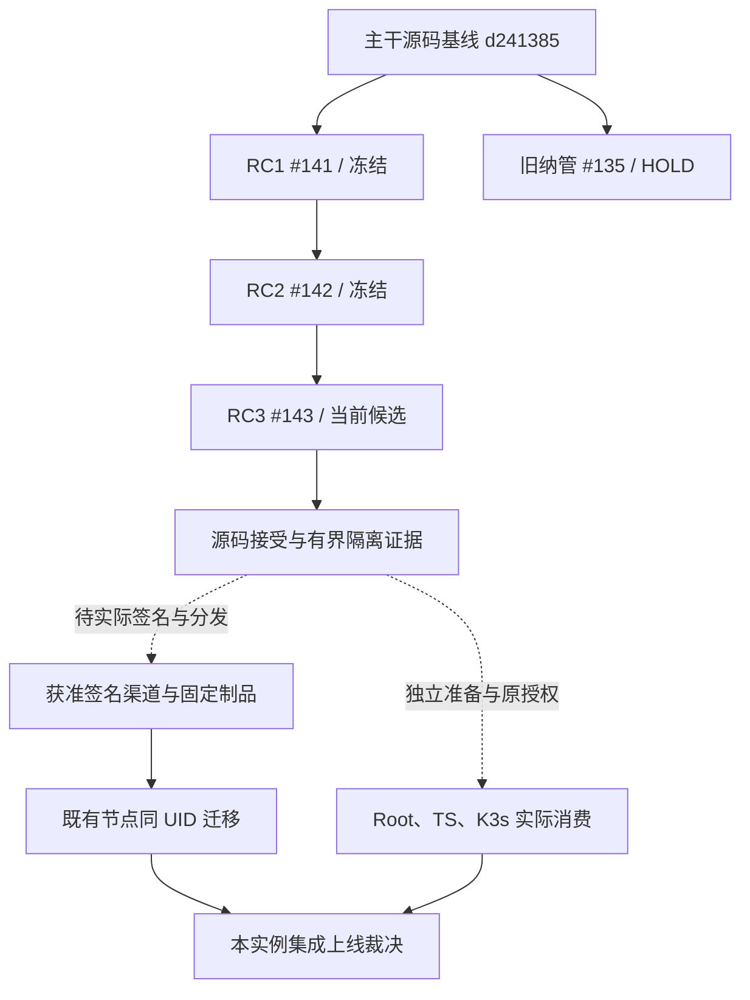
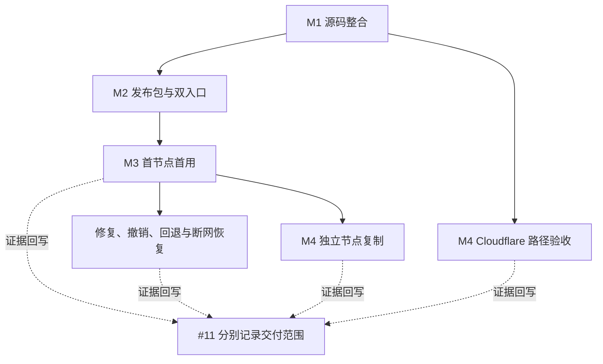

# 阶段交付 / Staged delivery

| 字段 / Field | 值 / Value |
| --- | --- |
| 文档性质 / Classification | `DERIVED`：交付条件与依赖导航，不是状态数据库 / Delivery criteria and dependency navigation, not a status database |
| `source_pointer` | [#11 当前目标与回执](https://github.com/youling/ghostfleet/issues/11)；[统一安装合同](https://github.com/youling/ghostfleet/issues/11#issuecomment-7218722415)；[RC3 评审](https://github.com/youling/ghostfleet/pull/143#pullrequestreview-6091711303) |
| 文档核对日期 / Documentation checked | `2026-11-28`；恢复时须核对原 Issue/PR live refs，不表示已经部署 / Revalidate live refs; this is not deployment evidence |

## 当前恢复入口：0.3.0 RC3

**当前最新候选为 RC3，源码接受与隔离证据已有回执；正式签名、首个既有节点迁移和 Stable 尚未完成。** [#11](https://github.com/youling/ghostfleet/issues/11)是唯一产品主线，#3 管架构治理，#36 管标准传输，#64 管准入，#69 管旧资源/attempt 收口。各条原 Work 的 owner 和独立验收继续有效，保留一个现场工头统一对接。

| 分支角色 | 精确来源 | 状态与恢复方式 |
| --- | --- | --- |
| 主干 v1 基线 | `d24138597fea41c74400f741ddd9634b40d8a7e8` | 已合入的旧实现；本次主干文档整理不把 nextgen 源码合入，也不证明现役版本。 |
| RC1 审计基线 | [#141](https://github.com/youling/ghostfleet/pull/141) · `943ad828e09c58b85fa095361018fd97722913c6` | 冻结源码与原审计材料，Draft。 |
| RC2 返修基线 | [#142](https://github.com/youling/ghostfleet/pull/142) · `99f33081b5af806da0032a8f91466443e8eb3535` | RC1 的后继，源码候选已接受，Draft；原制品不可覆盖。 |
| RC3 统一安装器 | [#143](https://github.com/youling/ghostfleet/pull/143) · `4b2a039dc6bce169d8b00ecd34736017df1732db` | RC2 的后继，`0.3.0~rc3`，Draft；[工头隔离回执](https://github.com/youling/ghostfleet/issues/11#issuecomment-7219492224)与[架构复核](https://github.com/youling/ghostfleet/pull/143#pullrequestreview-6091711303)分别说明证据。 |
| 旧纳管集成线 | [#135](https://github.com/youling/ghostfleet/pull/135) · `99d3d72655e405da60038c3514e50057c6f7c4e5` | HOLD，与 RC3 分叉；未被新版包含或宣布替代。 |
| 研究资料 | [#140](https://github.com/youling/ghostfleet/pull/140) · `b8d4a38edb7440a7331d4ddd9e9994848251300a` | 设计输入，不是独立待部署版本。 |

当前可执行源码与操作指针：[统一安装器](https://github.com/youling/ghostfleet/blob/4b2a039dc6bce169d8b00ecd34736017df1732db/nextgen/host/install.py)、[profile schema](https://github.com/youling/ghostfleet/blob/4b2a039dc6bce169d8b00ecd34736017df1732db/nextgen/install-profile.schema.json)、[操作手册](https://github.com/youling/ghostfleet/blob/4b2a039dc6bce169d8b00ecd34736017df1732db/docs/nextgen/OPERATIONS.md)、[候选架构](https://github.com/youling/ghostfleet/blob/4b2a039dc6bce169d8b00ecd34736017df1732db/docs/nextgen/ARCHITECTURE.md)。固定候选中的 `docs/nextgen/CURRENT.md` 仍是 R0–R6 / RC1 时期的恢复说明；本节与 #11 的更新回执提供后继导航，不改冻结发行字节。

### 版本与现场依赖图

图源为上表与[集成交付裁决](https://github.com/youling/ghostfleet/issues/11#issuecomment-7217955618)。版本之间的实线是 Git 祖先关系；现场框的实线是该动作自身的必要依赖；虚线是尚待原 owner 验收的工作。无一表示已经发布。实际消费者的准备与独立试验可并行，不要求等待全部源码线或无关现场项。

相对上一阶段，本次恢复入口从 RC1 提升到 RC3，增加统一安装器和版本化 profile 的证据；没有改变主干运行代码、正式签名、实例身份或权限。公共 K3s 仍可选，本实例的集成交付范围则包含 K3s；两者不互相替代。

### 现场下一步与证据边界

| 原工作线 | 已有证据 | 仍需完成的具体交付 |
| --- | --- | --- |
| 可信发行 | RC3 两环境首装/接管与最终 CI；原 RC1 灰度的签名/Pull/no-op 历史回执 | 以最终 RC3 制品重新核对批准对象、信任根、渠道、期限与回退；真实 429/恢复、签名发布、定时 Pull、版本/no-op/失败保护。旧 RC2 授权描述不自动覆盖 RC3。 |
| 既有节点迁移 | 统一入口保留身份的隔离试验；真实节点 intake 由原 owner 持有 | 同源兼容控制面、同一 DO/UID/凭据、受信 profile、唯一写者、独立 SSH 救援及迁移后真实消费者读回。 |
| Root | 原 owner 持有普通消费者与既有审批链证据 | 当前有效的有界授权、真实连续管理员消费及撤销/到期证据；公共安装器不实现或签发它。 |
| TS / CF | 原路径的有界连接证据 | #64 完整现行策略/Controller 身份、正控与反向/横向拒绝、备用路径和恢复。旧 A09 FAIL 不被源码改写；它只阻断依赖未证实隔离的动作。 |
| K3s | [工作站隔离双来宾回执](https://github.com/youling/ghostfleet/issues/11#issuecomment-7218509279)已覆盖调度、真实 API、日志/RBAC、重启和撤销 | 目标实例的获准存储/资源、固定制品、实际工作负载和恢复读回；工作站试验不等于目标节点已安装。 |

已有独立测试与隔离回执按版本/范围复用，不重复整套审计。原工头应先完成可在当前权限内准备的 profile、发布和回退材料，再由原正式机制处理确需的新批准；不能让未指定的所有者输入变成无限期“等 owner”占位。凭据、完整策略和实例拓扑留私有来源。

### 旧线替代对账

祖先核对确认 #128–#134、#136–#139 的固定 HEAD 均在 #135 中；其中 #136 已合并到旧线，其余仍有开放候选入口。#135 不在 RC3 祖先链上。以下只完成源码/合同层面的映射，不能替代实例消费者和回退证据，也不自动关闭原 PR。

| 旧候选 | RC3 对应接缝或处置 | 尚不能据此宣布替代的部分 |
| --- | --- | --- |
| #128、#130、#132 同 UID、配对与 host bootstrap | 新邀请/profile、持久 pending 凭据、`enroll.py` 与统一 `install.py` | 旧短码/可信客户端、真实消费者及现役来源的切换和恢复。 |
| #129、#131 旧制品打包 | `release.py`、签名 APT、固定 bootstrap 与 reporter 制品 | 旧分发入口和仍被消费的固定摘要；新旧发行机制不能仅按功能名视为等价。 |
| #133、#138 私有 decision readback / retained pins | 新版节点/观察证据可供消费者对账 | 旧命名 service entrypoint、历史 pin 回读是否仍被私有 broker 使用；未取得替代证明。 |
| #134 Access 单登录 | 候选可复用上游 Access，应用仍检查各自角色凭据 | 旧自动打开 Console 的完整体验与真实消费是否需要迁移，不能由“支持 Access”推定等价。 |
| #137 自定义 reporter unit 映射 | v1 兼容与新版原生观察分别保留 | 真实自定义 unit 的配置和接管读回。 |
| #139 多 Controller 通用语义 | 已有后发裁决与候选角色表，本次主干导航同步 | 旧七文件分支仍留原证据；真实 Controller 及准入不由文档验收。 |
| #140 设计研究 | 固定 SHA 留作 ARCH-0 输入 | 研究资料不是发行载荷，不强制复制全部文件。 |

按[既有保留裁决](https://github.com/youling/ghostfleet/issues/11#issuecomment-7197717929)，只有消费者、回退与独立未完验收核清后，才能逐项提出关闭或退役。各子 PR 已进入 #135 只证明代码包含，不证明 #135 或 RC3 已交付相同现场能力。架构师负责裁决，原工头仅补其掌握的现场缺口。

### Current recovery summary

RC3 `4b2a039dc6bce169d8b00ecd34736017df1732db` is the current candidate. RC1 → RC2 → RC3 is Git ancestry, not a merged or deployed release sequence. #135 is a separate HOLD lineage; #140 is research input. The pinned candidate's CURRENT page still describes the earlier RC1 stage, so resume through #11 and this dated navigation.

Source and bounded isolated evidence are accepted. Actual RC3 signing/channel approval, canary Pull, same-UID migration, Root/TS/K3s consumer evidence and Stable promotion remain with their existing owners. Reuse completed tests; prepare concrete profile/release/rollback inputs before requesting any genuinely missing authorization. The old-line table records source mappings and unresolved consumers, not feature-equivalence or retirement acceptance.

## 0.3.0 之后的配置管理规划 / Post-0.3.0 configuration-management plan

Human 已同意纳入 Ansible 配置管理方向，暂以 0.4.0 为规划目标。范围、责任与验证以 [#11 规划记录](https://github.com/youling/ghostfleet/issues/11#issuecomment-7227108988)为准。该路线独立于 0.3.0 的发布、迁移和现场验收。

- **配置与执行。** 获准控制端按需运行固定版本的 Ansible，复用已有 Profiles 和身份校验。实例 owner 维护实际清单、配置和授权。候选通用接缝沿用现有 UID、SSH 信任和结果读回。GhostFleet 继续负责自有安装和签名更新，每项受管配置由一个明确的 owner 写入。
- **首轮验证。** 先在可丢弃的原生 Debian 与 WSL Debian 上验证公共用户态基线及平台适配。Windows 保留原生应用、硬件、构建和调试。WSL 使用 Linux 文件系统承载工作树与热缓存，按权限明确的本机交换目录交接输入和产物。远端制品传输继续沿 [#36](https://github.com/youling/ghostfleet/issues/36)。
- **验收。** 核对目标后生成差异计划，经授权对单目标执行并读回实际状态，再复跑验证零差异和故障恢复。Windows 原生自动化、WSL 纳管和生产推广各自需要适用的实测证据。

The Human approved planning for Ansible-based configuration management, with 0.4.0 as the working target. [The decision and validation scope in #11](https://github.com/youling/ghostfleet/issues/11#issuecomment-7227108988) govern this work. The 0.3.0 release, migration and field acceptance proceed independently.

- **Configuration and execution.** An authorized controller runs a pinned Ansible version on demand and reuses existing profiles and target verification. Deployment owners retain the actual inventory, configuration and authorization. Candidate product integration reuses existing node UIDs, SSH trust and result readback. GhostFleet owns its installer and signed updates. Each managed configuration resource has a single writer.
- **Initial validation.** Prove the common userspace baseline and platform adaptations on disposable native Debian and WSL Debian. Windows keeps native apps, hardware access, builds and debugging. WSL keeps active worktrees and caches on its Linux filesystem and uses scoped local directories to exchange inputs and outputs. Remote artifact transport follows [#36](https://github.com/youling/ghostfleet/issues/36).
- **Acceptance.** Verify the target, plan the changes, apply to a single authorized target and read back actual state. Confirm a no-change rerun and test recovery. Windows native automation, WSL enrollment and production rollout each require applicable field evidence.

## 主干 v1 交付说明

以下保留 ADR004 的 M1–M4 基座流程，适用于 v1 的源码与现场证据解释；RC3 使用上方固定操作手册和现行 #11 合同，不照搬旧票据或安装命令。

### 1. 范围与用法 / Scope and use

交付当前最小产品：原生 SSH、薄面板、一次性注册和 systemd/journald 心跳。当前进度、责任人、精确候选与接受结论留在 #11 及其引用的原工单、PR 和实例回执。本页不复制动态状态，不新开父工单。沿既有授权和责任线执行；源码整合不自动扩大生产、凭据或系统级安装权限。

Deliver the current minimal product: native SSH, a thin panel, one-time enrollment and systemd/journald presence. Current progress, owners, exact revisions and acceptance remain in #11 and its linked original work, PRs and instance receipts. This page creates no parallel status register or parent work item. Use existing authority and ownership; source integration does not expand production, credential or system-installation authority.

每阶段完成即可交付其实际覆盖的能力。只解决具体缺口，不新增固定观察期、框架、数据库或命令执行面。已经接受的证据在版本和范围仍适用时复用；有变更就核对变更影响。真实节点、域名、provider 定位符、凭据及原始日志留实例 owner，公开记录只保留脱敏摘要。

Deliver each stage's proven capability when complete. Resolve concrete gaps without adding a fixed observation period, framework, database or command plane. Reuse accepted evidence while its revision and scope remain applicable; assess the actual effect of later changes. Keep real node/domain/provider locators, credentials and raw logs with the instance owner; public records contain sanitized summaries only.

### 2. 交付条件 / Delivery criteria

| 阶段 / Stage | 交付物 / Deliverable | 完成证据 / Completion evidence |
| --- | --- | --- |
| M1 源码整合 / Source integration | 在既有候选线整合已审实现，修正文档，形成实际发布源码 / Integrate the reviewed implementation on the existing candidate line, reconcile docs and identify release source | 最终 HEAD/tree、适用审查、对应 CI、构建结果与发布物摘要；旧命令面未恢复；普通合并按当前委托 / Final HEAD/tree, applicable review, matching CI, build and artifact digests; no restored command plane; ordinary merge under current delegation |
| M2 发布包与 origin / Release package and origins | 一个 Worker、既有 DO 身份、panel/node 两个 HTTPS origin、实例覆盖及回退点 / One Worker, retained DO identity, two HTTPS origins, instance overlay and rollback reference | 按 PRESENCE 构建与 dry-run；实际发布后回读版本/路由；panel 的 Access、Operator/Read 与 node origin 边界正负测；公开安装器实际字节摘要匹配 / Build and dry-run per PRESENCE; after deployment read back version/routes, verify panel Access/Operator/Read and node-origin boundaries, and match the served installer digest |
| M3 首节点可用 / First node usable | 一个已有原生传输的授权节点完成实际系统级安装和受保护浏览器首用 / Actual system installation and protected-browser first use on one authorized node with existing native transport | **核心首用验收**：受保护浏览器签发票据→固定哈希安装/同节点更新→系统级 DynamicUser/LoadCredential timer/oneshot 自动运行→连续真实 heartbeat，journald 无配置权限错误，并确认既有 SSH 保留。repair、revoke、回退及网络中断恢复作为独立韧性验收，不由一次成功心跳推定通过 / **Core first-use acceptance**: protected-browser ticket → pinned install/same-node update → system DynamicUser/LoadCredential timer/oneshot runs automatically → repeated real heartbeats, no credential-permission error in journald, and existing SSH preserved. Repair, revoke, rollback and network-outage recovery are separate resilience checks; a successful heartbeat does not imply they passed |
| M4 可复制与传输补齐 / Replication and transport completion | 相同发布物部署第二节点；CF 路径独立完成 / Reuse the same release on a second node; complete CF transport separately | 第二节点身份/凭据/服务/回退分别有证据；CF 按 ACCEPTANCE 单独验收，只有两路均通过才声明双路 / Separate second-node identity, credentials, service and rollback evidence; validate CF through ACCEPTANCE and claim dual-path access only when both paths pass |

M2 的 dry-run 是“发布包已准备”，真实版本和鉴权回读才支持“面板已发布”。M3 的核心交付是“首节点可用”：必须有真实系统级自动心跳与原生 SSH 保持证据；repair/revoke/rollback/网络中断恢复是独立韧性验收，须单独留证，不能由 happy path 代替。M3 首节点验收不证明第二节点或双路远控。M4 的第二节点复制与 CF 接线可以并行，CF 也可在源码确定后按原授权提前推进。CF 未完成时保留其未验收状态，不撤销已经成立的单路或面板交付。

M2 dry-run supports “release package prepared”; actual version and authorization readback support “panel released.” M3's core delivery is “first node usable”: require real systemd-triggered heartbeats and preserved native SSH. Repair, revoke, rollback and network-outage recovery are separate resilience checks that need their own evidence; do not infer them from the happy path. M3 first-node acceptance does not prove a second node or dual-path remote control. M4 replication and CF work may proceed in parallel; CF may start once source is established and existing authority permits it. Pending CF acceptance does not invalidate proven single-path or panel delivery.

### 交付依赖图 / Delivery dependency diagram

图源是本节与 ADR004。实线表示前置依赖，虚线表示各分支独立回写证据；均不表示已经完成，也不要求所有分支同时完成后才记录交付。首节点首用与后续韧性验收分开表达；CF 分支独立于面板首用，汇总时分别陈述已证明的范围。

This section and ADR004 are the diagram sources. Solid edges are prerequisites; dashed edges are independent evidence writebacks. Neither means completion, and recording a delivered scope does not require all branches to finish together. First-node core acceptance and later resilience checks are separate; CF is independent of panel first use. The receipt distinguishes each proven scope.

### 3. 实例发布与首次使用 / Instance release and first use

操作步骤复用 [PRESENCE](PRESENCE.md)，原生传输复用 [REMOTE_ACCESS](REMOTE_ACCESS.md) 与 [ACCEPTANCE](ACCEPTANCE.md)。每次执行记录实际提交、安装器字节摘要、实例版本和回执指针；不要把另一环境的行尾或构建结果直接套用到本次发布物。

Use [PRESENCE](PRESENCE.md) for operations and [REMOTE_ACCESS](REMOTE_ACCESS.md)/[ACCEPTANCE](ACCEPTANCE.md) for native transport. Record the actual source commit, installer-byte digest, instance version and receipt pointer. Do not substitute a digest from another checkout's line endings or build for the artifact being served.

1. **发布边界 / Release boundary**：核对既有 Worker/DO、对象与 node_uid；保留前一版本、适用数据恢复点和仍在使用的旧消费者。两 origin 的精确路由、panel 全站 Access、不同的 Operator/Read 应用凭据由实例配置承载。实测匿名 panel 拦截、Read 写入拒绝、node origin 管理入口拒绝、错误/撤销凭据拒绝及正确安装器哈希。/ Reconcile existing Worker/DO, object and node_uid identity; retain the previous version, applicable data recovery point and live legacy consumers. Instance configuration owns exact origin routes, whole-panel Access and distinct Operator/Read credentials. Test anonymous-panel denial, Read-write denial, node-admin rejection, invalid/revoked credentials and the served installer digest.

2. **系统级首用 / System first use**：从真实受保护浏览器创建票据，在授权节点本地输入独立短码，验证固定发布物安装、systemd timer 自动触发的 oneshot、DynamicUser 与 LoadCredential 实际工作；至少观察多次真实心跳及 journald 无凭据权限错误，并确认原生 SSH 保持。仅有临时 user-unit、DOM 夹具或静态 unit 检查时，不声称完成本项。/ Create a ticket in the protected browser, enter the separate code locally on the authorized node, and observe the pinned installer, automatically triggered systemd timer/oneshot, DynamicUser and LoadCredential working. Observe repeated real heartbeats, no credential-permission error in journald, and preserved native SSH. Temporary user units, DOM fixtures or static unit checks do not establish this result.

3. **恢复与权限边界 / Recovery and authority boundary**：按已有测试范围验证本地 repair 复用已保存凭据、同节点重发不复制身份、旧 reporting 凭据失效，以及面板中断或撤销上报时既有 SSH 仍独立。记录上报恢复和本地 journal 诊断，不上传全量日志。真实系统范围未执行的项注明缺口，不用隔离测试代填。/ Within the existing test scope, verify repair using saved credentials, same-node reissue without identity duplication, invalidation of the old reporting credential, and native SSH independence during panel outage or reporting revocation. Record reporting recovery and local journal diagnostics without uploading the full journal. State any unexecuted live-system item rather than filling it with isolated-test results.

`DynamicUser` 的身份生命周期与 `LoadCredential` 的只读凭据投递由 [systemd 官方文档](https://www.freedesktop.org/software/systemd/man/latest/systemd.exec.html) 定义。记录实际安装的 systemd 版本；上游手册和临时用户服务测试都不替代该版本的系统级运行证据。

[Official systemd documentation](https://www.freedesktop.org/software/systemd/man/latest/systemd.exec.html) defines DynamicUser identity lifetime and LoadCredential's read-only credential delivery. Record the installed systemd version; neither the upstream manual nor a temporary user-service test replaces its actual system-service evidence.

### 4. 回退与完成声明 / Rollback and completion claims

面板代码回退与停用 reporter 分别记录。保留既有 DO 数据、node_uid、SSH 密钥和原生连接；安装器按自己的 manifest 处理文件，本地修改的文件不盲删。不要用删除 DO、重建节点或轮换全部 SSH/provider 凭据代替本功能回退。尚在使用的旧消费者必须有明确的切换和恢复安排。

Record panel-code rollback and reporter disablement separately. Retain existing DO data, node_uid, SSH keys and native connections. The installer follows its own manifest and refuses blind deletion of locally modified files. Do not replace feature rollback with DO deletion, node recreation or broad SSH/provider credential rotation. Existing consumers require a concrete cutover and recovery arrangement.

对已有 DO 类仅更新代码时，Cloudflare 不要求新增 class migration；应用仍须兼容已有数据。保留本项目既有 migration 与存储身份，不为当前交付切换存储生命周期机制。官方来源：[既有迁移语义](https://developers.cloudflare.com/durable-objects/reference/durable-object-class-migrations-legacy/)与[事务存储](https://developers.cloudflare.com/durable-objects/api/sqlite-storage-api/)。事务能力是机制依据，实际单消费和重启持久化仍由实现测试证明。

Cloudflare does not require a new class migration for a code-only update to an existing DO class; the application remains responsible for stored-data compatibility. Retain the existing migration and storage identity rather than changing lifecycle mechanisms for this delivery. See the official [legacy migration contract](https://developers.cloudflare.com/durable-objects/reference/durable-object-class-migrations-legacy/) and [transactional storage API](https://developers.cloudflare.com/durable-objects/api/sqlite-storage-api/). These support the design; implementation tests still establish single consumption and restart persistence.

回执分别说明“源码整合”“发布包准备”“面板发布”“首节点可用”“第二节点复制”“双路传输”的实际结果，并引用证据和剩余限制。达到哪个范围就交付哪个范围；不以 CI、心跳或计划替代未执行的现场能力。

The receipt distinguishes source integration, package preparation, panel release, first-node usability, second-node replication and dual-path transport, with evidence and remaining limits. Deliver each established scope without using CI, heartbeat or plans as substitutes for unexecuted live capability.

## 历史 ADR007 的 FULLY_MANAGED 验收

下表保留早期全新下位机的端到端验收场景，不是 RC3 已完成声明。早期特定 VPS、单 Controller 与不使用 VM 的实例安排见 [ADR007](adr/007-fully-managed-lower-node-enrollment.md) 原文；后发的多 Controller、既有节点迁移和隔离 VM 方向已在上方现行入口引用。实际目标与权限始终由原 owner 确认。

| Gate | 完成条件 | 不可替代的证据 |
|---|---|---|
| G0 Panel profile | Operator 能创建 `FULL_MANAGED_LOWER_NODE`，签发同一 immutable UID 的一次性 ticket/短码 | 真实受保护 Panel 操作、TTL/错误锁/重复 Claim 负测 |
| G1 Root bootstrap | 该历史场景的全新目标只需一次可信 root 引导和短码输入，固定摘要校验、预检、阶段 receipt | 该目标实际 shell/systemd receipt；不以 CI 或另一目标安装替代 |
| G2 Provider/transport | 自动发现并复用现有 TS/CF，建立原生 SSH、Host Key pin 和可恢复路径 | Provider readback + 从实际获准 Controller 发起的新 SSH 会话；Tunnel healthy 不是 origin SSH |
| G3 DCR | 同一 UID 自动进入动态 DCR catalog/target/policy，无逐节点源码改动 | 当前 ChatGPT 会话真实 `node.inspect` + typed Job receipt、准确策略版本 |
| G4 Root | 专用 root-probe + 一次 Owner 委托覆盖范围/期限的连续 Root maintenance session | ChatGPT 真实 Root receipt，至少两条连续无害 Root 命令、撤销/过期负测 |
| G5 FULLY_MANAGED | G0–G4 必需阶段全通过；修复/恢复路径可用 | Panel 最终状态与真实 ChatGPT 可操作性相互吻合 |

当前按既有节点迁移与独立场景的实际 readiness 推进，不再从这份历史表推导固定机器顺序或普遍排除 VM。兼容设备保留自己的只读存储探测。Panel 状态投影不能覆盖现有 NodeLifecycle/Presence，也不能把 `UNKNOWN` 伪装成完成。每阶段失败保留同一 Node UID 和已有 Provider/SSH 成果，走 repair/resume；不得自动创建第二身份或重复消费票据。

**动态 DCR 是全自动的硬前置。** 现有每节点 `runtimeTarget.ts` 常量与 Wrangler VPC binding 若要求人工改源码/部署，尚不满足 G3。由私有 Fleet owner 在现有 Worker/DO 上完成审核过的动态 UID/transport/policy 消费；不能为此另建第二 Worker/第二身份控制面。
