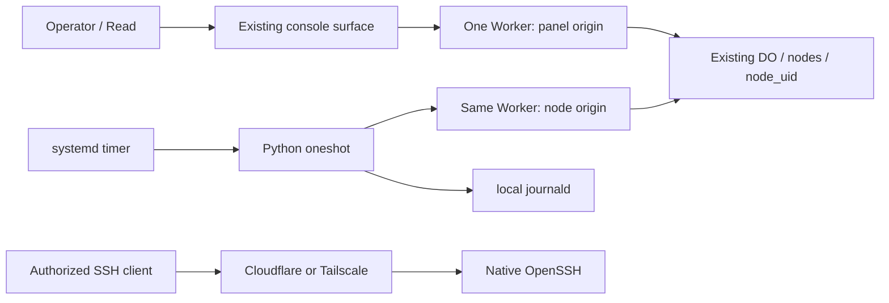

# ADR 004 — Lightweight enrollment and presence / 轻量纳管与心跳

Decision date: 2026-11-15. Direction accepted by Human in [#11](https://github.com/youling/ghostfleet/issues/11). The implementation is integrated into main; the instance owner has reported M2 Worker deployment and M3 first-node systemd acceptance, with exact evidence and remaining gates tracked in [#11](https://github.com/youling/ghostfleet/issues/11). This ADR records the accepted product/architecture decision, not a live deployment ledger. Supersedes only the transport-only exclusion of a panel/reporting plane. It does not revive the older command/Helper/JIT program.

## 中文

### 决定

GhostFleet 保留原生 SSH 传输，另提供一个薄面板和一次性心跳程序。面板只负责注册、上报凭据、节点列表和最后收到的本机服务状态；不执行命令。节点以 systemd timer 调度 Python 标准库 oneshot 程序，本地诊断进入 journald。无新的常驻 Agent、任务队列、数据库服务器或命令审计框架。

复用旧主干 `0cbb9c17bdd298634e4ccebf2c1a9c50d9f09fe1` 的 `console/shared/console.css`、`appearance.js`、`first-use.js` 和 `src/adapters/cloudflare/auth.js` 原始 Blob。复用既有 Worker/DO 的类名、`global` 对象名、`ghostfleet-state` 存储键与 `nodes/node_uid` 身份。票据的短码、过期、撤销与哈希交付采用已有安全机制；不整包搬回旧 controller、模板引擎、七类证据验收和 capability bundle。加密、HTTPS、事务、调度和日志使用原生库/上游组件，不自行实现。

### 最小模型与失败语义

`nodes[node_uid]` 是唯一节点记录。新节点是 `PROVISIONAL`；旧记录的 lifecycle、资产归属和其他字段保留。新增 `reporting` 是旁接的观测/凭据状态，首次心跳不把旧 `ACTIVE` 语义重新定义成在线。

Operator 签发时预留稳定 node_uid；随机票据定位符与独立八位短码有效十分钟，五次错误锁定。成功 claim 原子消费票据并交付一个 256-bit 节点专属 reporting token；服务器仅存摘要。凭据只允许写本节点心跳，不是 SSH、提供商或 Operator 权限。HTTP 超时不盲目重试 claim：Operator 为同一 node_uid 重发，旧 reporting token 失效，不再造节点。本机已经保存凭据但后续安装失败时使用 `repair`，不再 claim。

心跳使用服务端接收时间。最多 4 KiB 的严格 JSON 仅包含协议、boot_id、reporter_version、三项本机 unit 状态。只保存最新观测，不逐次追加事件/日志。状态是 `active/inactive/failed/activating/deactivating/reloading/not_found/unknown`，缺失服务不是节点离线。Presence 是 PENDING、ONLINE（不超过180秒）、STALE（不超过600秒）、OFFLINE、REVOKED 或 UNKNOWN 的派生展示，不证明入站 SSH、隧道端点或远程命令可用。

### 单一参考部署

一个 Worker、一个既有 DO 命名空间。两个 origin 指向同一 Worker：panel origin 由实例所有者配置全站 Access，另有应用 Operator/Read 鉴权；node origin 仅开放受票据/节点凭据鉴权的 claim/heartbeat 和公共哈希固定安装器。node origin 不提供面板或管理 API。两者生产必须使用不同 HTTPS origin；仅隔离 loopback 测试允许合一。没有第三个 mint 服务、资产 Worker 或自建 OAuth issuer。

注册只接管已有可用传输的状态监看。v1 安装器不安装 Tailscale/cloudflared/OpenSSH，不修改 authorized_keys、普通用户认证、提供商策略或存储。现有 SSH 不依赖面板存活。撤销上报不撤销 SSH；这在 API 和 UI 中明确显示。尚未建立传输的新主机仍沿原生传输安装指南处理，不把“心跳在线”称为端到端远控纳管完成。

### Linux 与边界

一个独立 Python 文件内含 reporter、安装/修复/移除与两个 unit 模板。system service 使用 DynamicUser 和 LoadCredential，config 为0600；无长期新增账户、无 sudoers、无密钥环境变量。安装只写自己的固定路径，不覆盖未标记的其他程序；清理依据自己的文件摘要清单，遇到本地改动拒绝盲删。真实 root 安装、Access/DNS 与发布需实例 owner 执行；临时 user-unit 联调不冒充生产 DynamicUser 安装验收。

## Derived architecture / 派生架构

Source: this ADR and #11. Scope: current product architecture. This diagram describes component relationships, not per-instance deployment or acceptance. Solid edges describe implemented interfaces; production release and field acceptance remain evidenced in #11.

## English

Keep native SSH separate from reporting. Reuse the existing Console styling, first-use classifier and application authentication verbatim; reuse the existing Worker/DO persistence and node_uid identity. A thin controller replaces the obsolete execution/controller surface rather than restoring the old stack. No command API, job queue, resident agent, provider mint service or second database is introduced.

A ticket reserves one stable node identity. Ten-minute expiry, five-code lockout, atomic one-use claim and digest-only reporting credential storage protect enrollment. Lost claim responses require explicit reissue for the same node, invalidating the former reporting credential. Local installation failures after credential persistence use repair. Presence does not promote lifecycle or prove SSH/provider connectivity; the server receipt time is authoritative for freshness. Reporting revocation is explicitly not SSH revocation.

One Worker and one existing DO serve two exact origins. The deployment owner protects the panel with Access; Operator and Read bearer roles remain separate application authority. The node origin exposes only ticket-authenticated claim, node-authenticated heartbeat and the hash-pinned public installer. It never serves the panel/admin API. The same-origin HTTP exception is restricted to loopback tests.

The Linux client uses Python standard libraries, systemd oneshot/timer, DynamicUser, LoadCredential and journald. It installs only its own files, never SSH/provider/account policy. No root password is transmitted. Native transport setup precedes reporting enrollment. A received heartbeat proves an authenticated outgoing report, not successful inbound administration. Existing native SSH continues during panel outages.

Deployment is a separate owner action. Temporary user-systemd integration, local Workerd/DO runtime tests and static unit validation do not prove production system-unit installation, DNS/Access policy or public service readiness. See [the deployment runbook](../PRESENCE.md).
