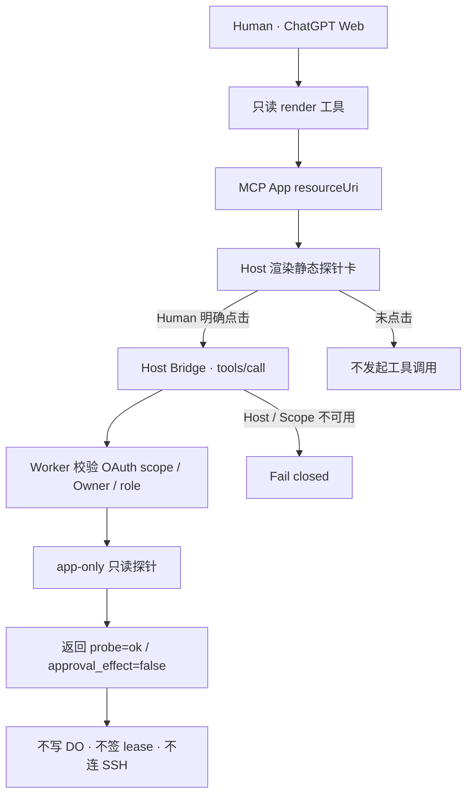
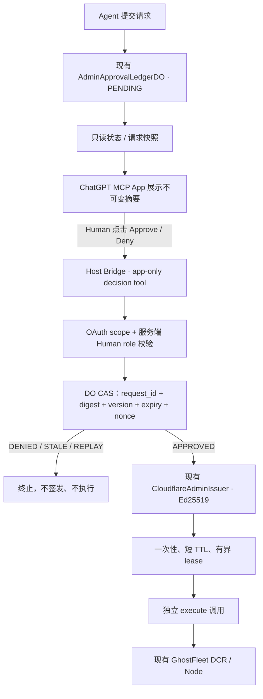
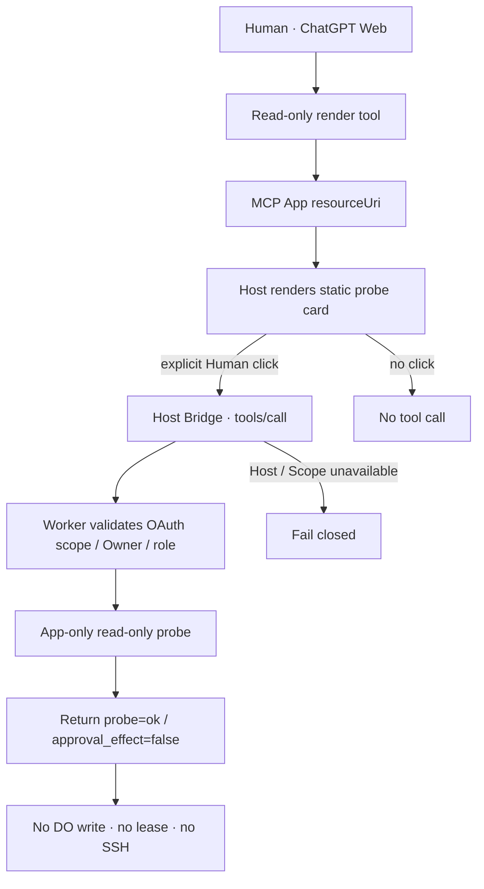
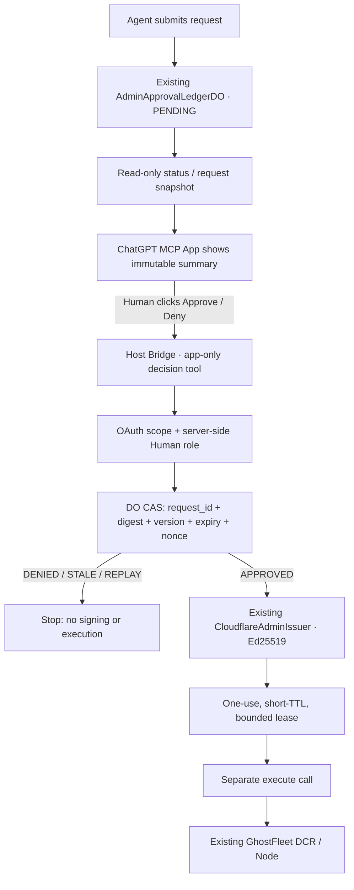

# ChatGPT in-chat approval: Phase 0 probe / 对话审批 Phase 0 探针

status: `SOURCE_PROBE_ONLY / NOT_HOST_VALIDATED / NO_APPROVAL_EFFECT`
owner: GhostFleet optional ChatGPT client adapter; deployment integration stays with each private instance owner.
parent: [GhostFleet #69](https://github.com/youling/ghostfleet/issues/69)

## 中文

<!-- topic:purpose -->
### 用途和边界

这是可选的 **ChatGPT Web 平台能力探针**，不是真实 Human 审批卡片。它测试沙箱 UI 是否能在明确按钮点击之后，通过 ChatGPT Host Bridge 调用一个只读 app-only 工具。它不能批准、拒绝、签发租约、创建管理员请求或执行主机命令；缺少 Host 功能时显示拒绝状态。

- Public source: `packages/typed-control/src/compat/chatgptApprovalPhase0.ts`。
- 包入口：`@ghostfleet/typed-control/chatgpt-approval-phase0`（opt-in；不会被默认 typed-control / MCP 工具列表激活）。
- 资源 URI：`ui://ghostfleet/admin-approval-phase0/v1.html`。
- MIME：`text/html;profile=mcp-app`。
- Scope 常量：`fleet.privileged.approve`，与公共 `PRIVILEGED_APPROVE_SCOPE` 保持一致。

MCP Apps 约定：模型可见的**只读渲染工具**通过 `_meta.ui.resourceUri` 指向资源；隐藏于模型工具清单的**只读探针工具** `fleet_admin_ui_probe` 必须标记 `_meta.ui.visibility: ["app"]`。工具必须自行验证真实 OAuth scope 和 Human 角色，不能信任工具参数自报身份。不能因为资源里有按钮就认为宿主已提供不可伪造的人类点击证明。

<!-- topic:wiring -->
### 接线与安全验收

由私有部署 owner 在测试环境中用现有 MCP Server 注册静态资源和一个无副作用的 `fleet_admin_ui_probe`，返回：

```json
{"structuredContent":{"probe":"ok","approval_effect":false},"content":[{"type":"text","text":"Phase 0 only"}]}
```

必须符合以下条件：仅在**真实用户点击**后尝试调用；App 渲染时零请求；无需客户端 token、localStorage 或 widgetState；没有生产设备标识和密钥；缺少 Host Bridge、OAuth scope、Human role 或返回不完整时拒绝并显示诊断状态。探针代码为了不增加依赖，暂使用 ChatGPT 官方兼容别名 `window.openai.callTool`，它映射到 MCP Apps `tools/call`；此源码没有证明原生 `ui/initialize` / `tools/call` 流已由当前 Host 接受。正式兼容性仍以实际 Host 实机测试为准。

**必需区分三种证据：**

1. `SOURCE_TEST_PASS`：静态资源、按钮触发负测与工具声明/Node 检查通过。
2. `WEB_HOST_PROVEN`：合资格的 ChatGPT Web 工作区实际加载卡片，按钮触发 app-only 工具且 OAuth scope 能在服务器验证；模型工具清单不可直接调用探针。
3. `ADMIN_APPROVAL_PROVEN`：必须另由真正的 Human 决策卡片及 DO/Issuer/Node 端到端验收，Phase 0 探针不可能单独证明。

官方文档指针：OpenAI Developers “Add UI to your MCP server” 与 “Authentication”；MCP Apps 官方规范。当前自定义 MCP Server 连接是 ChatGPT Web only，原生移动端不可直接推定可用；用户所处 Plan/工作区权限在实际连接前为 `UNVERIFIED`。

<!-- topic:flow -->
### 流程图：当前探针与未来真实审批必须分开

**A. 当前 Phase 0 探针（已实现源码，尚未做真实 Host 验收）**



**B. 目标审批链（设计目标，不属于本轮 Phase 0 已实现范围）**



目标链必须继续区分审批状态与执行状态；Host 隐藏工具不是授权本身，OAuth scope 也不是点击证明。Phase 0 不注册真实 decision/execute 新入口，不触碰 DO 与签发器。

<!-- topic:rollout -->
### 不能跨越的门禁

本探针源码可以提交、测试、Review；不能凭测试通过直接部署到生产 Worker、修改 Access/OAuth secret、替用户发起/批准真实申请或执行 JG/TP/OMV8 管理员命令。Phase 0 Web 受信 UI 与授权通过后，才可在既有 GhostFleet #69 / 私有部署 owner 工作线下实现 `fleet_admin_human_decide` 和真实审批卡片。后续必须维持一套账本、一套签发器与既有 Host 执行权限边界。

## English

<!-- topic:purpose -->
### Purpose and boundaries

This is an optional **ChatGPT Web platform capability probe**, not the actual Human approval card. It tests whether a sandboxed UI can call a read-only app-only tool through the ChatGPT Host Bridge after an explicit button click. It cannot approve or deny, sign a lease, create an admin request, or dispatch a host command. It fails visibly when Host capability is unavailable.

- Public source: `packages/typed-control/src/compat/chatgptApprovalPhase0.ts`.
- Opt-in package entry: `@ghostfleet/typed-control/chatgpt-approval-phase0`, never enabled by the default typed-control/MCP catalog.
- Resource URI: `ui://ghostfleet/admin-approval-phase0/v1.html`.
- MIME: `text/html;profile=mcp-app`.
- Scope: `fleet.privileged.approve`, matching the public `PRIVILEGED_APPROVE_SCOPE`.

Under the MCP Apps contract a model-visible **read-only render tool** links to the resource through `_meta.ui.resourceUri`. The model-hidden **read-only probe tool** `fleet_admin_ui_probe` must declare `_meta.ui.visibility: ["app"]`. It separately verifies the actual OAuth scope and Human role; tool arguments never assert identity. A button alone is not an unforgeable Human-click attestation.

<!-- topic:wiring -->
### Wiring and acceptance

In a test environment, the private deployment owner registers this static resource and an inert `fleet_admin_ui_probe` handler in the existing MCP server, returning:

```json
{"structuredContent":{"probe":"ok","approval_effect":false},"content":[{"type":"text","text":"Phase 0 only"}]}
```

Required behavior: tool calls happen only after a **real click**, never during rendering; no client bearer, localStorage or widgetState, production node IDs or keys; fail visibly if Host bridge, OAuth scope, Human role or response integrity is missing. To avoid adding a runtime dependency, the probe currently uses the documented ChatGPT compatibility alias `window.openai.callTool`, mapping to MCP Apps `tools/call`. The source does not establish native `ui/initialize` / `tools/call` acceptance by a live Host. Real Host tests are mandatory.

Keep three evidence classes distinct:

1. `SOURCE_TEST_PASS`: static resource, click-only tests and tool/Node checks pass.
2. `WEB_HOST_PROVEN`: an eligible ChatGPT Web workspace actually renders the card, its button invokes the app-only tool with validated OAuth scope, and the model cannot invoke that tool from its catalog.
3. `ADMIN_APPROVAL_PROVEN`: separate full Human decision card, DO/Issuer/Node end-to-end evidence. A Phase 0 probe cannot establish this.

Official references: OpenAI Developer Docs “Add UI to your MCP server” and “Authentication”; the MCP Apps specification. Custom MCP server connections currently support ChatGPT Web only; native mobile is not implied. User-specific plan/workspace eligibility remains `UNVERIFIED` until an actual connection.

<!-- topic:flow -->
### Diagrams: current probe versus future real approval

**A. Current Phase 0 probe (source implemented; live Host not yet validated)**



**B. Target approval path (design target, not implemented by this Phase 0 patch)**



The target path must keep approval state separate from execution state. Host-hidden visibility is not authorization, and OAuth scope is not proof of a click. Phase 0 registers no real decision/execute entry and does not touch the DO ledger or signer.

<!-- topic:rollout -->
### Remaining gates

Source may be committed, tested and reviewed; passing tests does not authorize production Worker deployment, Access/OAuth secret changes, actual approval requests or privileged TP/JG/OMV8 execution. Only after trusted Web UI and OAuth acceptance should the existing GhostFleet #69 and deployment owner implement the real `fleet_admin_human_decide` and approval card, reusing the single existing ledger, issuer and Host execution authority.
