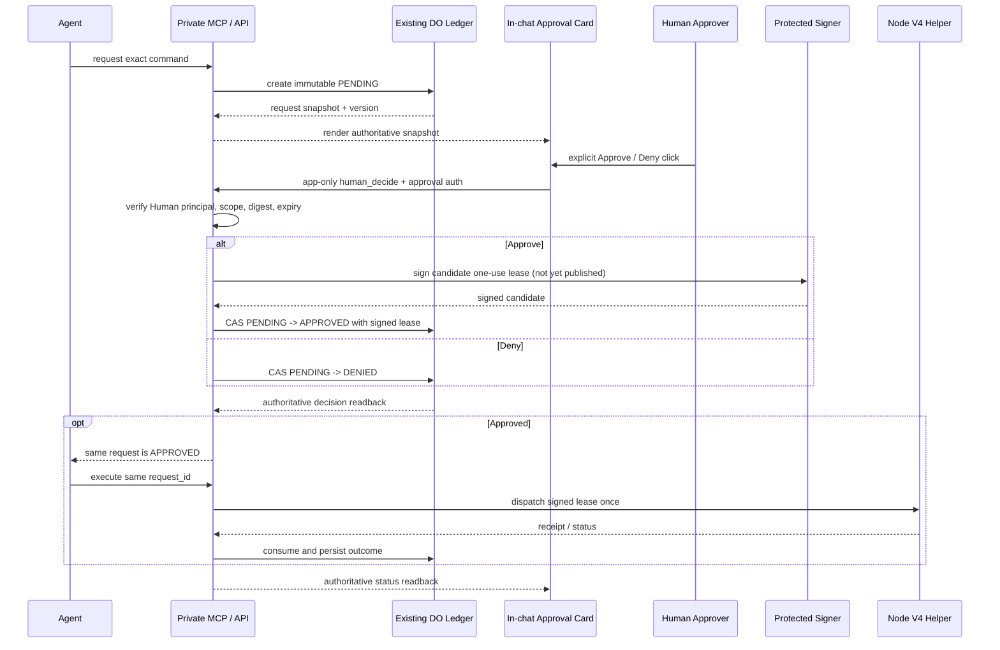
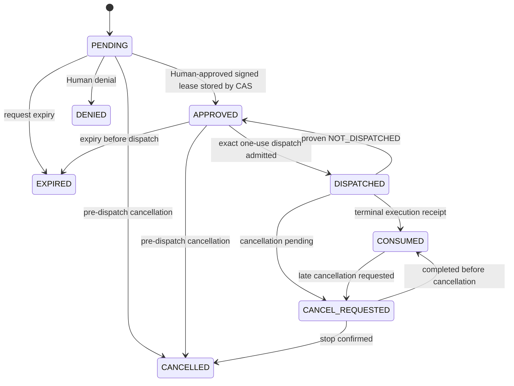

# In-chat Human approval v1 / 对话内人工审批 v1

status: `TARGET_DECIDED / WEB_POC_REQUIRED / NATIVE_MOBILE_BLOCKED_FOR_CUSTOM_MCP`
owner: GhostFleet owns the generic interaction contract; each deployment owner owns its private issuer, transactional ledger, credentials and deployment bindings.
parent: [GhostFleet #69](https://github.com/youling/ghostfleet/issues/69)
last_updated: 2026-11-10

## 中文

<!-- topic:decision -->
### 1. 产品裁决

`IN_CHAT_HUMAN_APPROVAL = PRIMARY`。

人工审批的正常路径必须发生在当前 ChatGPT 对话中。Cloudflare Access / Operator 页面仅作为明确的恢复与灾难备用路径，不是每次审批的默认跳转目标。

本规范是 GhostFleet 的可选 ChatGPT MCP App 集成合同，不改变 AI-client-neutral core，也不把 ChatGPT、OAuth 或 Cloudflare 变成核心运行依赖。

沿用现有 GhostFleet #69 的产品裁决：

- 不创建第二套审批账本、签发器或管理员权限层。
- 部署专属的事务账本、可信签发器、Ed25519 租约及节点 Helper 仍由各自部署 owner 持有。
- GhostFleet 只定义可复用的 UI、MCP 工具、认证边界和验收合同，不公开或复制部署专属实现。
- 普通执行身份不因接入 UI 或 OAuth 而获得管理员权限。

<!-- topic:platform -->
### 2. 平台能力与限制

截至本文件日期，OpenAI 官方资料确认：

- ChatGPT Web 支持自定义 MCP Server 和 MCP App 交互界面。
- 自定义 MCP Server 连接及完整 MCP 写操作当前要求 Business 或 Enterprise/Edu 工作区；具体账户和工作区权限仍须实测。
- 官方帮助中心明确表示自定义 MCP Server 连接目前仅支持 Web，不支持原生 ChatGPT Mobile。
- MCP OAuth 支持 OAuth 2.1、按工具声明 `securitySchemes`、scope 授权及服务端逐次验证。
- ChatGPT 可在额外 scope 需要时重新授权；`id_token_hint` 只是可选的登录上下文延续机制。
- ChatGPT 对写操作的确认提示由应用权限和动作上下文决定，不能当作不可伪造的密码学用户点击证明。

官方参考：
- OpenAI Help Center: “Connecting custom MCP servers in ChatGPT”
- OpenAI Developer Docs: “Add UI to your MCP server”
- OpenAI Developer Docs: “Authentication”

因此，平台状态必须分别记录：

| Surface | 状态 | 规则 |
| --- | --- | --- |
| ChatGPT Web custom MCP App | `WEB_POC_REQUIRED` | 可开发；必须完成真实 Host Bridge、OAuth 和 UI 点击验收 |
| Native ChatGPT Mobile custom MCP App | `BLOCKED_BY_HOST_PLATFORM` | 官方当前不支持；禁止假设 Web App 自动可用 |
| Existing Fleet DCR on native mobile | `UNVERIFIED` | 独立实测；不能由 custom MCP 文档推断其能力 |
| Cloudflare Access / Operator fallback | `RECOVERY_ONLY` | 仅在用户明确选择恢复路径时使用 |

若原生移动端没有受信的审批交互路径，移动端特权执行必须 fail closed。不得把聊天文字“批准”、模型生成文本或普通工具确认降级为审批凭据。

<!-- topic:identity -->
### 3. 身份与信任模型

必须区分：

| Principal | 含义 | 权限 |
| --- | --- | --- |
| Agent/workload principal | 发起命令申请的模型、Agent 或自动化工作负载 | 可创建、查询、取消申请；不能批准或签发 |
| Human approver principal | 通过独立认证与审批授权的真实操作员主体 | 可对精确待审批请求作出一次批准或拒绝 |
| Node execution principal | 节点专用 ops 身份及 root Helper | 只消费已签名、节点绑定、未过期的一次性租约 |

不能仅用 `requester_user_id !== human_approver_user_id` 定义主体隔离。真正需要隔离的是 Agent/workload principal 与 Human approver principal。发起业务工作的同一位人类用户可以亲自批准该工作，但审批必须由独立的人类认证上下文完成，不能由 Agent bearer 自批。

OAuth `sub` 只能证明当前令牌代表哪个身份；scope 只能证明令牌被授予什么权限。二者都不能单独证明此刻有人点击了批准。

MCP Apps 的 `visibility: ["app"]` 是 Host 侧工具可见性/调用路由约束：Host 不应把该工具列入模型工具目录，并应拒绝 App 调用不含 `app` 可见性的工具。但它不是服务端 OAuth 授权，也不会给服务端提供独立的逐调用来源证明。双可见工具的模型调用与 App 调用在服务端可能无法区分，见 [MCP Apps issue #738](https://github.com/modelcontextprotocol/ext-apps/issues/738)。因此审批工具必须 app-only，不能双可见；服务端仍须校验审批 scope、Human 主体、请求摘要和 DO 状态。

<!-- topic:interaction -->
### 4. MCP App 交互合同

模型可见工具：

- `fleet_admin_request_command`：创建不可变的 PENDING 请求。
- `fleet_admin_review_pending`：只读返回权威请求快照。
- `fleet_admin_command_status`：只读查询同一请求状态。
- `fleet_admin_command_execute`：执行已批准的同一请求；服务端重新验证完整状态和租约。

App-only 决策工具：

- `fleet_admin_human_decide`：设计为只供审批卡片按钮调用，声明 `_meta.ui.visibility: ["app"]`；必须在 Phase 0 证明 Host 会拒绝模型/普通工具调用，未证实前不得启用。
- 只接受 `request_id`、请求摘要/版本及 `approve | deny` 等最小必要输入。
- 不接受调用方自报的 Human 身份、批准布尔值、租约、私钥或签名材料。
- 服务端仍须独立认证 Human approver principal、审批角色和当前授权 scope。

审批卡片必须从服务端返回的权威快照渲染，不信任模型生成的命令摘要。至少展示：

- 请求 ID、目标节点、发起 Agent/Work；
- 完整 argv、cwd、环境摘要、执行器摘要及外部输入风险；
- 目的、风险、副作用、回滚计划；
- TTL、最大运行时间、输出策略和到期时间。

卡片提供明确的 Approve / Deny 操作。窄屏优先展示关键风险与摘要，展开后可查看完整命令细节。卡片渲染本身绝不能触发审批或执行。

<!-- topic:oauth -->
### 5. OAuth、用户在场与服务端仲裁

推荐先验证按工具 scope 的 OAuth 方案，例如现有常量 `fleet.privileged.approve`：

1. 普通 Agent 工具只拥有普通请求/查询/执行所需 scope。
2. `fleet_admin_human_decide` 单独声明现有 `PRIVILEGED_APPROVE_SCOPE`（`fleet.privileged.approve`），不另造 `fleet.admin.approve` 同义 scope。
3. 使用 MCP OAuth 资源服务器元数据和 per-tool `securitySchemes`；按官方要求配置授权服务器发现、PKCE、resource、issuer identification 和 scope。每个部署都必须确保其 OAuth 支持 scope 清单与 consent 描述包含该 scope。
4. 服务端每次请求验证签名、`iss`、`aud/resource`、`exp/nbf`、scope、撤销状态和主体映射。
5. 必须实测 ChatGPT Host 对 app-only 工具的实际执行：模型工具目录不包含该工具，App 可经 Host Bridge `tools/call` 调用，Host 拒绝越权调用；同时验证该调用具备审批 scope。不能把自定义 `_meta` 参数或服务端收到的普通 `tools/call` 当成来源证明。
6. 若 Host 无法执行 app-only 过滤/调用约束，或无法把审批 scope 授予该调用，先保持该路径 BLOCKED，并向 Human 提交可选补救方案（例如独立 Human step-up）供裁决；不得自行把 WebAuthn/passkey 或额外权限层升级为强制产品要求，也不得发明 Host 签名的“用户点击证明”。

审批决定必须绑定：

`request_id + request_digest + ledger_version + expiry + one_time_nonce + approver_principal`

现有 DO 账本使用原子 CAS，只允许一个终态决定胜出。批准后由现有受保护 signer 签发节点 V4 可消费的一次性 Ed25519 租约。签名私钥不能进入浏览器 iframe、widgetState、localStorage、模型参数或普通 Agent/Worker 可读空间。

不得把 30 天 bearer 或可复用审批 token 放在客户端。短期 OAuth access token 由 Host 按授权协议管理；任何 refresh/session policy 均由服务端控制，具备撤销与重新认证策略。

<!-- topic:diagrams -->
### 6. 时序与状态图

**上图仅表示 `AdminApprovalRecord.state`，并非 OS 执行结果。** 当前审批状态枚举不包含 `UNKNOWN`、`SUCCEEDED`、`FAILED`、`STOPPED` 或 `RECONCILE_REQUIRED`。前四者属于独立的 `dispatch_state` 值；后一项是 `reconcile_required` 布尔标记。比如账本状态仍为 `DISPATCHED` 时，执行结果可以是 `UNKNOWN` 且需要对账。签名候选在现行实现中先生成，只有事务 CAS 成功后才产生权威 `APPROVED` 记录，预签名本身不构成已批准。

`UNKNOWN` 不允许创建新请求来掩盖旧请求，也不允许盲目重复派发。所有恢复都沿用原 request/lease 进行对账。

<!-- topic:acceptance -->
### 7. Phase 与验收门

| Phase | 交付 | 通过条件 |
| --- | --- | --- |
| 0A | Web Host feasibility | 实测 App resource、Host Bridge `tools/call`、App-only visibility、per-tool OAuth scope 和真实按钮交互 |
| 0B | Mobile feasibility | 独立验证现有 Fleet DCR 是否有原生移动端受信审批 UI；custom MCP mobile 当前按官方限制视为 blocked |
| 1 | GhostFleet generic contract | 通用审批卡片、工具 schema、窄屏布局、服务端状态回读和双语文档 |
| 2 | Deployment integration | 复用部署现有事务账本、issuer、Ed25519 和恢复入口，不新增账本/签发器 |
| 3 | Canary | Web 路径验收通过后才允许创建一笔真实 PENDING；用户在卡片明确点击；同一请求执行一次并终态回读 |

必须覆盖的负向测试：

- Agent principal 直接调用 app-only 决策工具；
- 缺失、错误或被撤销的审批 scope；
- Human 与 Agent 主体混淆；
- 请求摘要、账本版本、节点或命令被替换；
- 过期、重复点击、nonce 重放和并发 CAS；
- UI 自动渲染触发动作；
- Host token 刷新、重新授权和账号切换；
- 派发后响应丢失、UNKNOWN 和同请求恢复；
- Web 与原生移动端分别验收，不能互相代替。

### 8. 当前实现状态

截至 2026-11-10：

- GhostFleet 公共仓库目前提供通用特权命令与审批合同；本规范定义的 ChatGPT MCP App 卡片和 app-only 决策工具仍属于待实现的可选客户端集成，不代表已部署。
- 公共 typed-control 已定义 `PRIVILEGED_APPROVE_SCOPE = fleet.privileged.approve`，并纳入通用 scope 常量。新集成应复用此名称，不再创建同义 scope。
- 每个私有部署必须独立核验自己的 OAuth Provider 是否实际支持该 scope、consent 是否正确展示、审批工具是否声明 per-tool `securitySchemes`，以及 Host 是否强制执行 app-only 可见性。公共仓库无法替部署 owner 声称这些能力已上线。
- 部署专属事务账本、租约签发器、凭据与节点绑定继续由部署 owner 管理；本规范不要求创建第二套账本或签发器。
- 本文不记录私有仓库路径、部署资源名称、密钥、内部节点标识或私有工单编号。

- 产品裁决：`IN_CHAT_HUMAN_APPROVAL = PRIMARY`。
- 客户端 HAST 30 天：`REJECTED`。
- ChatGPT Web MCP App：`WEB_POC_REQUIRED`。
- Native ChatGPT Mobile custom MCP：`BLOCKED_BY_HOST_PLATFORM`。
- Existing Fleet DCR native mobile：`UNVERIFIED`。
- 各目标节点是否 READY、是否可创建请求、是否可执行，必须以各自私有部署工单的当前证据为准；本公共规范不授予执行权限。
- NAS 等实例的独立冻结边界不受本规范改变。

任何源码合并、合成测试通过或 Host 预检通过，都不能替代 UI、真实身份和单笔金丝雀验收。

## English

<!-- topic:decision -->
### 1. Product ruling

`IN_CHAT_HUMAN_APPROVAL = PRIMARY`.

The normal approval journey must take place inside the current ChatGPT conversation. The Cloudflare Access / Operator page is an explicit recovery and disaster fallback, not the routine destination for every approval.

This is an optional ChatGPT MCP App integration contract. It does not change the AI-client-neutral core or make ChatGPT, OAuth, or Cloudflare a mandatory core dependency.

Continue the existing GhostFleet #69 product decision:

- Do not create a second approval ledger, issuer, or administrator permission tier.
- Deployment-specific transactional ledger, trusted signer, Ed25519 lease and node Helper remain owned by each deployment owner.
- GhostFleet owns only the reusable UI, MCP tool, authentication-boundary and acceptance contracts; it does not publish or duplicate deployment-specific implementation.
- Ordinary execution identity does not gain administrator authority merely by using the UI or OAuth.

<!-- topic:platform -->
### 2. Platform capabilities and limitations

As of this document date, official OpenAI documentation confirms:

- ChatGPT Web supports custom MCP servers and interactive MCP App interfaces.
- Custom MCP server connections and full MCP write actions currently require Business or Enterprise/Edu workspaces; account and workspace permissions still need verification.
- The Help Center explicitly says custom MCP server connections are currently Web-only and are not supported in native ChatGPT Mobile.
- MCP OAuth supports OAuth 2.1, per-tool `securitySchemes`, scope authorization and per-request server verification.
- ChatGPT can reauthorize when additional scopes are needed; `id_token_hint` is an optional login-context optimization.
- ChatGPT write-action confirmation prompts depend on app permissions and action context. They are not cryptographic proof of a user click.

Official references:
- OpenAI Help Center: “Connecting custom MCP servers in ChatGPT”
- OpenAI Developer Docs: “Add UI to your MCP server”
- OpenAI Developer Docs: “Authentication”

Track platform status independently:

| Surface | Status | Rule |
| --- | --- | --- |
| ChatGPT Web custom MCP App | `WEB_POC_REQUIRED` | Buildable; real Host Bridge, OAuth and UI-click acceptance required |
| Native ChatGPT Mobile custom MCP App | `BLOCKED_BY_HOST_PLATFORM` | Not currently supported by official documentation; do not assume Web Apps work natively |
| Existing Fleet DCR on native mobile | `UNVERIFIED` | Test independently; do not infer its capability from custom MCP documentation |
| Cloudflare Access / Operator fallback | `RECOVERY_ONLY` | Use only when the user explicitly chooses the recovery path |

If native mobile has no trusted approval interaction, privileged execution from mobile must fail closed. Chat text saying “approved”, model-generated text, or ordinary tool confirmation must never become an approval credential.

<!-- topic:identity -->
### 3. Principals and trust model

Distinguish three principals:

| Principal | Meaning | Authority |
| --- | --- | --- |
| Agent/workload principal | Model, Agent or automation workload requesting a command | May create, inspect and cancel requests; cannot approve or sign |
| Human approver principal | Authenticated operator with independent approval authority | May approve or deny one exact pending request |
| Node execution principal | Node-specific ops identity and root Helper | Consumes only a signed, node-bound, unexpired one-use lease |

Do not define separation solely as `requester_user_id !== human_approver_user_id`. The security boundary is between the Agent/workload principal and the Human approver principal. The same human who initiated the business work may approve it, but the decision must use an independent human-authentication context; an Agent bearer must never self-approve.

OAuth `sub` proves which identity a token represents. A scope proves which permission was granted. Neither alone proves that a person clicked Approve at that moment.

MCP Apps `visibility: ["app"]` is a Host-side tool visibility/routing constraint: the Host must omit the tool from the model tool list and reject App calls to tools without `app` visibility. It is not server-side OAuth authorization and does not provide the server with independent per-call origin attestation. Model and App calls to a dual-visible tool may be indistinguishable at the server boundary; see [MCP Apps issue #738](https://github.com/modelcontextprotocol/ext-apps/issues/738). Therefore the decision tool must be app-only, never dual-visible; the server still validates approval scope, Human principal, request digest and DO state.

<!-- topic:interaction -->
### 4. MCP App interaction contract

Model-visible tools:

- `fleet_admin_request_command`: create an immutable PENDING request.
- `fleet_admin_review_pending`: read the authoritative request snapshot.
- `fleet_admin_command_status`: read the same request's status.
- `fleet_admin_command_execute`: execute the same approved request after complete server-side state and lease validation.

App-only decision tool:

- `fleet_admin_human_decide`: designed for the approval-card button only and declared with `_meta.ui.visibility: ["app"]`; Phase 0 must prove that the Host rejects model/ordinary-tool invocation before this tool is enabled.
- Accept only the minimum required inputs, such as `request_id`, request digest/version and `approve | deny`.
- Never accept caller-asserted Human identity, approval booleans, leases, private keys or signing material.
- The server must independently authenticate the Human approver principal, approval role and current authorization scope.

Render the card from the authoritative server snapshot, not a model-generated command summary. Show at least:

- Request ID, target node, requesting Agent/Work;
- Exact argv, cwd, environment summary, executable digest and external-input risks;
- Purpose, risk, side effects and rollback plan;
- TTL, maximum runtime, output policy and expiry.

Provide explicit Approve / Deny actions. On narrow screens, show key risks and a compact summary first, with full command details expandable. Rendering the card must never trigger approval or execution.

<!-- topic:oauth -->
### 5. OAuth, user presence and server-side arbitration

Prototype per-tool OAuth scopes first, using the existing `fleet.privileged.approve` constant:

1. Ordinary Agent tools receive only the scopes required for normal request/read/execute operations.
2. `fleet_admin_human_decide` declares the existing `PRIVILEGED_APPROVE_SCOPE` (`fleet.privileged.approve`); do not create `fleet.admin.approve` as a synonymous second scope.
3. Use MCP OAuth resource-server metadata and per-tool `securitySchemes`; configure discovery, PKCE, resource, issuer identification and scopes as required by the official contract. Each deployment must ensure its OAuth supported-scope list and consent description include this scope.
4. On every request, verify signature, `iss`, `aud/resource`, `exp/nbf`, scope, revocation state and principal mapping.
5. Test actual ChatGPT Host enforcement for app-only tools: the tool is absent from the model tool list, the App can call it through Host Bridge `tools/call`, and the Host rejects unauthorized invocation; also verify that the call receives the approval scope. Do not treat custom `_meta` arguments or an ordinary server-side `tools/call` as origin proof.
6. If the Host cannot enforce app-only filtering/call restrictions, or cannot grant the approval scope to that call, keep this path BLOCKED and present optional remedies (such as independent Human step-up) for Human decision. Do not unilaterally make WebAuthn/passkey or another permission tier mandatory, and never invent a Host-signed “user clicked” assertion.

Bind every decision to:

`request_id + request_digest + ledger_version + expiry + one_time_nonce + approver_principal`

The existing DO ledger uses atomic CAS so only one terminal decision wins. After approval, the existing protected signer issues a one-use Ed25519 lease consumable by the node V4 path. Signing private keys must never enter the browser iframe, widgetState, localStorage, model arguments or ordinary Agent/Worker-readable storage.

Do not store a 30-day bearer or reusable approval token on the client. The Host manages short-lived OAuth access tokens under the authorization protocol; any refresh/session policy remains server-controlled with revocation and reauthentication.

<!-- topic:diagrams -->
### 6. Sequence and state diagrams

**The diagram represents `AdminApprovalRecord.state` only, not OS execution outcomes.** The approval-state enum does not contain `UNKNOWN`, `SUCCEEDED`, `FAILED`, `STOPPED` or `RECONCILE_REQUIRED`. The first four are values of the separate `dispatch_state` field; the last is a boolean `reconcile_required` marker. For example, the ledger state may remain `DISPATCHED` while execution is `UNKNOWN` and requires reconciliation. The current implementation signs a candidate before CAS; only a successful CAS creates the authoritative `APPROVED` record, and a precalculated signature is not an approval.

`UNKNOWN` must not be hidden by creating a new request, and must never trigger blind redispatch. Recovery reconciles the original request/lease.

<!-- topic:acceptance -->
### 7. Phases and acceptance gates

| Phase | Deliverable | Acceptance |
| --- | --- | --- |
| 0A | Web Host feasibility | Real App resource, Host Bridge `tools/call`, app-only visibility, per-tool OAuth scope and button interaction |
| 0B | Mobile feasibility | Independently verify whether existing Fleet DCR has a trusted native mobile approval UI; custom MCP mobile remains blocked under current official guidance |
| 1 | Generic GhostFleet contract | Reusable approval card, tool schemas, narrow-screen layout, server status readback and bilingual docs |
| 2 | Deployment integration | Reuse the deployment's existing transactional ledger, issuer, Ed25519 and recovery path; add no second ledger or issuer |
| 3 | Canary | Only after Web acceptance, create one real PENDING request; require explicit card click; execute once and read back terminal status |

Required negative tests:

- Agent principal directly calls the app-only decision tool;
- Missing, incorrect or revoked approval scope;
- Human/Agent principal confusion;
- Request digest, ledger version, node or command substitution;
- Expiry, duplicate click, nonce replay and concurrent CAS;
- UI rendering triggers an action;
- Host token refresh, reauthorization and account switching;
- Lost response after dispatch, UNKNOWN and same-request recovery;
- Separate Web and native mobile acceptance; neither substitutes for the other.

### 8. Implementation status

As of 2026-11-10:

- The public GhostFleet repository provides the generic privileged-command and approval contract. The ChatGPT MCP App card and app-only decision tool defined here remain an optional client integration to be implemented; this document does not claim they are deployed.
- Public typed-control already defines `PRIVILEGED_APPROVE_SCOPE = fleet.privileged.approve` and includes it in the shared scope constants. New integrations should reuse this name rather than create a synonymous scope.
- Each private deployment must independently verify that its OAuth Provider supports this scope, that consent presents it correctly, that the decision tool declares per-tool `securitySchemes`, and that the Host enforces app-only visibility. The public repository cannot claim these deployment capabilities are live.
- Deployment-specific transactional ledgers, lease signers, credentials and node bindings remain owned by each deployment owner; this contract does not require a second ledger or signer.
- This public document does not record private repository paths, deployment resource names, secrets, internal node identifiers or private issue numbers.

- Product ruling: `IN_CHAT_HUMAN_APPROVAL = PRIMARY`.
- Client-side 30-day HAST: `REJECTED`.
- ChatGPT Web MCP App: `WEB_POC_REQUIRED`.
- Native ChatGPT Mobile custom MCP: `BLOCKED_BY_HOST_PLATFORM`.
- Existing Fleet DCR native mobile: `UNVERIFIED`.
- Whether a target node is READY, may receive a request, or may execute must be determined from current evidence in its private deployment work item; this public contract grants no execution authority.
- Independent NAS and other deployment-specific frozen boundaries are unchanged by this contract.

Source merges, synthetic test passes and Host preflight do not substitute for UI, real identity and single-request canary acceptance.
