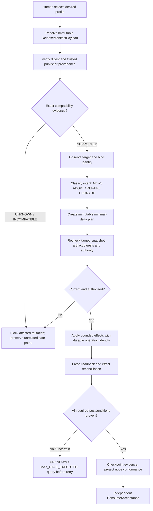

# Versioned enrollment and reconciliation flow / 版本化纳管与收敛流程

status: `DERIVED_ARCHITECTURE_VIEW`
canonical_contract: [VERSIONED_ENROLLMENT_RECONCILE_V1.md](VERSIONED_ENROLLMENT_RECONCILE_V1.md)
parent: [GhostFleet #11](https://github.com/youling/ghostfleet/issues/11)
candidate: [PR #78](https://github.com/youling/ghostfleet/pull/78)

This diagram is a navigation projection of the S1–S3 proposal. It does not implement a release resolver, signer, reconciliation executor, durable journal, or runtime acceptance.

## 中文

## English

The flow separates immutable release identity from mutable channel selection, and separates compatibility evidence, per-node conformance, and independent consumer acceptance. An unresolved or uncertain effect is reconciled by querying durable state before retry; a plan projection or checkpoint alone is not proof of a fully managed node.

## Evidence boundary

- S1–S3 are candidate contracts, not runtime implementation.
- The 24 VE acceptance cases remain `NOT_RUN`; CI validates the specification structure only.
- `SUPPORTED` requires an exact artifact/version/protocol/platform/capability tuple and independently readable evidence.
- Provider credentials, private deployment bindings, real node facts and production actions remain with the private deployment owner.
- OMV8 and other protected storage/business resources remain outside any unapproved write set.

