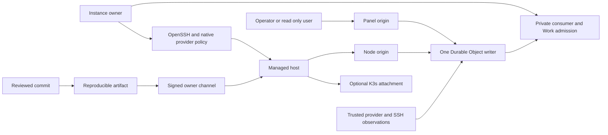

# GhostFleet 下一代架构

适用范围为 [#11 的下一代专项](https://github.com/youling/ghostfleet/issues/11#issuecomment-7193635084)。源代码候选与现役并行。初始验证平台为 Debian 13，目标产品版本暂定 0.3.0。平台适配按实测结果扩大。

## R0 世界模型

| 依据 | 精确范围 | 当前解释 |
| --- | --- | --- |
| [主干](https://github.com/youling/ghostfleet/tree/d24138597fea41c74400f741ddd9634b40d8a7e8) | 68 个文件，ADR004–007 | 已提交的产品合同与基础实现；不推定部署。 |
| [#135](https://github.com/youling/ghostfleet/tree/99d3d72655e405da60038c3514e50057c6f7c4e5) | 77 个文件，35 个变更文件 | Draft/HOLD。测试与反例输入。 |
| [#140](https://github.com/youling/ghostfleet/tree/b8d4a38edb7440a7331d4ddd9e9994848251300a) | 两份设计资料 | 原设计位于 5a71e62b；本方案重新选择接缝。 |
| [#3](https://github.com/youling/ghostfleet/issues/3)、[#11](https://github.com/youling/ghostfleet/issues/11) | 现役治理与 P0 | 两条责任线保持独立；M0 是既有工头的研究派单。 |
| [#64](https://github.com/youling/ghostfleet/issues/64)、[#36](https://github.com/youling/ghostfleet/issues/36) | A09 仍 FAIL_ALLOW_ALL；原生 SSH/SFTP 有界历史验收 | 可达、认证、方向隔离、普通 Job 是独立事实。 |
| 实例侧候选合同 | 受信目标、admission、Work、Secret custody、运行时和发布各由实例持有 | 公共候选只交接可验证事实；私有候选与运行时可能分叉。实际凭据、部署与租约由实例 owner 持有。 |

| 旧路径与证据 | 取舍 | 新版行为与验证 |
| --- | --- | --- |
| `presence.js`、`http.js`、`presence.test.mjs` | 兼容桥 / 重写新注册 | 保留 class、object name、snapshot key、node_uid、v1 报文和 reporting hash；旧与新测试分别验证。撤销和同 UID 恢复共用节点记录。 |
| `cloudflare/auth.js`、#135 Access tests | 保持旧面，独立审阅新面 | Panel 与 Node 两个 origin，角色分离；实例可在 Panel 入口复用 Access，origin 继续检查服务端凭据。 |
| ADR007、`enroll-managed.py`、`managed-bootstrap-host.py` | 重写首次配对 | 先由 operator 发高熵的一次性邀请；节点端带预置信任引导。未经认证的请求无法预占记录。先验 artifact 和 profile，再触碰主机。 |
| `heartbeat.py`、`test_heartbeat.py`、ADR006 shadow | 保持 v1，重写有界新版报告与投影 | 继续兼容已有 service manager；分离 agent 自报、SSH、TS、CF 与 K8s 观测。凭据只可写自身状态。 |
| `join.sh`、`build-presence.mjs`、release tests | 保持旧构建，重写发行路径 | 已审 Git 源码生成确定性包，原生 APT 验证签名链，按渠道 pull；同 UID、配置与 SSH 独立。 |
| `config/ssh`、`config/sshd`、`REMOTE_ACCESS.md`、A09 | 复用原生运输和现有配置 | 区分 pinned SSH 实际认证和 Provider 的连接证据。独立救援使用现有 OpenSSH。 |
| `console/` | 保留统一入口，新增版本与证据视图 | 用户按能力和来源查阅；旧 Console 仍可独立构建。 |
| OMV phase0、旧 helper / queue / SSH relay | 保留 appliance 只读探测；旧执行平台退役范围仍由原治理负责 | 首次发行仅验证 Debian，未知安装所有权及冲突转人工。 |
| `publication-guard.mjs`、CI 与 AGPL | 复用 | 只提交保留域名和合成材料，公开流水线只构建与测试。 |

公开工单和源码不承载真实资产标识、域名、指纹或日志。上表的现役裁决沿原证据窗口有效。候选验证不提升任何实机结论。参见 [#135 审查](https://github.com/youling/ghostfleet/pull/135#issuecomment-7129365134)、[企业先验](https://github.com/youling/ghostfleet/issues/11#issuecomment-7192430009) 与 [可选 K3s 接缝](https://github.com/youling/ghostfleet/issues/11#issuecomment-7192302399)。

## R1 决策

ARCH-0 判为生产核心加独立候选。复用已有状态存储身份和公开协议，同时在隔离环境验证新的生命周期逻辑。核心采用 ECMAScript 模块与标准库，运行于现有 Worker/DO 边界。主机工具使用 Debian 自带 Python、APT、systemd 和 OpenSSH。这个组合可以用当前测试工具复跑，避免新守护进程、控制库与运行时。DO 交易序列化邀请消费、撤销与旧报告写入，候选配置单独处理；未来切换必须读回原 class/binding/object 与快照。独立新库会增加双写、恢复和 UID 漂移风险。参见 [Cloudflare migrations](https://developers.cloudflare.com/durable-objects/reference/durable-objects-migrations/)。

### 角色与接口

| 主体 | 允许 | 拒绝与故障处理 |
| --- | --- | --- |
| Operator / read-only | Panel 角色分别写入邀请、撤销、期望和读取投影 | 使用不同凭据；浏览器写入限定同源。 |
| Managed host | 邀请消费、只报告自身、拉取公开包、按实例授权使用指定服务 | 无凭据签发、发布写权、Controller 目标或其他节点管理权。失陷隔离由可信端执行，删除本机凭据不构成隔离。 |
| 可信观测 | 以独立发布凭据提交带节点绑定和范围的观测 | 不签发邀请、不改变 Work 准入。过期与冲突保持可见。 |
| Controller / 实例消费者 | 按私有权威分配、认证目标并交给原生 transport | Fleet UID、心跳、标签和集群 Ready 不足以授予控制权限；多个 Controller 各自凭据、目标 scope 和救援路径。 |
| Build / signer / promotion | 固定 Git 提交得到发行候选；实例在隔离发布域签署已审渠道 | 节点和普通 CI 只读。Latest 标签不决定发布。 |

以下为隔离候选接缝。Node 提供 `POST /v2/claim` 与 `POST /v2/nodes/{uid}/evidence`，保留旧 v1 heartbeat。Panel 提供 `GET /v2/nodes`、`POST /v2/invitations` 及对确切 UID 的撤销与期望更新。凭据交付不经过请求 URL。首次消费原子绑定 UID、受审 profile 和新 reporter hash；客户端在网络请求前持久化自己生成的 secret。相同请求可确认已提交结果，旧凭据和异节点重用必须拒绝。旧 v1 票据走旧源，切换窗口先停发两套注册入口。Panel 只向实例消费者提供证据；SSH host key、网络政策、操作和 Work scope 由可信实例另验。需长期保留的数据在旧字段旁增量存放，迁移与回退须先演练。

### 发行与回退

可重复构建使用确切提交、版本、目标平台与包摘要。只从预置 `Signed-By` 的专用 APT 渠道下载。APT 原生验证 `InRelease`、到期、索引和包字节。候选只带固定的 GhostFleet 自有文件，验证后用原子指针激活；原生 SSH、Provider 和注册记录均在制品之外。冷启动信任由 operator 独立预置。自动更新比较本地已激活版本，只前进；回退由发布者以更大的包版本重新授权已知好字节。受影响包和渠道均限在专用 APT 状态内。首次信任窗口内，仍有效但未见过的较早签名索引可达；如需要抵御更强冻结模型或跨平台更新，再采用同一发行物的成熟 TUF 客户端替换 APT 后端。参见 [APT sources](https://manpages.debian.org/trixie/apt/sources.list.5.en.html)。

GitHub 可保存固定摘要制品。目标仓库的 immutable releases 开关经只读 API 返回 false，本源码交付不依赖设置变更。正式晋升由独立发布 owner 确认，canary 与 stable 可引用相同包字节。

### 原生纳管、观测与验收

TS grants 和目标 OpenSSH 策略在可信侧默认拒绝，Cloudflare Edge 与 origin 连通性分别验证。K3s 采用原生受审版本、独立 Agent token 和 CA pin，绑定 cluster identity / Kubernetes Node UID，既有服务的 adoption 与新组件申请走不同阶段。512 MiB Agent 是实验输入。真实实验使用隔离双机，记录资源、错误 pin、撤销、WAN/quorum 和救援。普通 Debian 主机场景可跳过计算接入。参见 [TS grants](https://tailscale.com/docs/features/access-control/grants)、[CF Tunnel observability](https://developers.cloudflare.com/tunnel/observability/)。

| 环境 | 证据 |
| --- | --- |
| SOURCE | 代码、固定提交、确定性核验与 publication scan。 |
| ISOLATED | 本地 Worker/DO、合成签名 APT、可丢弃 OS/服务的实际试验。 |
| CONSUMER | 独立实际用户身份、可信 admission 和私有消费链。 |
| PRODUCTION | 现役版本、Provider 侧拒绝、原生救援与 owner 有界 canary。 |

R2 建第一条纵向链，R3 完成签名渠道和主机更新，R4 补原生能力和健康，R5 演练迁移，R6 由独立验证者复跑固定候选。后两类验收取现行 owner 证据。R1 关闭前，以下假设交给后续测试裁决：旧快照原子回读、签名渠道实验、可信 Provider 证据适配、512 MiB 资源及撤销对照。

## English operations summary

Build and test the candidate in an isolated Worker environment. Keep the existing node identity and reporter credentials during migration. Provision the release trust root and channel outside the bootstrap response. Run the node updater independently of provider services and SSH. Approve rollback as a new signed version containing reviewed known-good content. Report host, consumer and production results only for the environment actually exercised.
