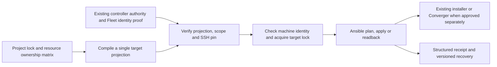

# GhostFleet 0.4 configuration and execution / 配置与执行

## Linux First

通用改动在原生 Linux 或 WSL Debian 的 Linux 文件系统施工。TS/Node、Python、Rust、Git 与静态分析共享项目版本锁。Windows 桌面、设备、驱动、原生构建和调试继续由宿主管理，Windows 原生任务使用固定 PowerShell 脚本。WSL 按独立运行环境核对，不继承 Windows 的节点 UID 或管理权限。

Ordinary builds use Bash and native Linux storage, including in Debian under WSL. Windows keeps native tasks in fixed PowerShell scripts. The runtime identifies the requested OS, shell, distro, user and working directory explicitly. A WSL stopped receipt leaves the distribution stopped. The Windows host owner controls startup and native software.



## Project compilation and release gate / 项目编译与发布门

Use the [locked profiles and matrix](../../config/management/README.md) to compile a UID and platform selection. Compilation validates immutable layer bytes, explicit cross-domain path aliases, resource types and owners, duplicate writers and relevant overlap. The same check runs before any configuration connection and in CI. A generated inventory lasts one attempt. Real node addresses, UID bindings, account material and authorization remain with the original owner.

项目配置通常由基线、平台适配、能力层和单节点覆盖组成。包、路径、unit、端口、路由、凭据、存储和生命周期在连接前过矩阵。Windows 样例使用观察范围。经批准修改 Debian 或 WSL 的具体文件前，先验证实际挂载与父目录权限。显式别名把中性的项目路径映射到实例 owner 已批准的位置。

## One-target runbook / 单目标运行手册

Use a Linux controller with pinned `ansible-core 2.19.11`, native OpenSSH and Python. Keep the controller inputs in an owner-controlled directory. The owner supplies a short-lived `ghostfleet-config-authority/v1` file, with its existing verified Fleet identity input and gate. The scope binds one node UID and platform, controller UID and machine identity digest, projection digest, allowed operations and expiry. It also binds the target SSH address, login, exact host key and key file reference, target machine identity digest, the target-owned lock file and the exact Ansible entrypoint. See the [authority envelope example](../../config/convergence/authority.example.json) for the exact field names. The host owner provisions the target lock once in an owner-controlled directory. Use one canonical lock path on a persistent local ext4, XFS or Btrfs filesystem for every authorized controller and
recovery attempt on that target. The owner preserves the lock inode and its adjacent reservation across restarts.
Use the same accepted controller revision throughout a rollout. Close the previous write entrypoints and confirm their
in-flight operations are terminal before enabling this revision. Earlier candidates did not check the reservation.

控制端每次重新编译项目锁，把目标投影和现有授权逐项核对，再通过既有 Fleet 身份门。首次 SSH 使用固定主机密钥。目标核对机身标识和平台后，持有同一个锁到本次结束。等待锁的第二个写者会被拒绝。目标在派发 apply 前把同目录的 `<lock>.pending` 落盘。只有当 Ansible 成功结束、写后读回通过且授权仍有效，
控制端才在同一持锁会话确认完成。断线、超时或授权到期，若无法确认提交，回执为 `UNKNOWN`。目标仍有未决
记录时，新的 plan、apply 和 verify 返回 `TARGET_RECOVERY_REQUIRED`。

```sh
python3 -I scripts/ghostfleet_converge.py plan \
  --lock "$PROJECT_LOCK" --authority "$OWNER_AUTHORITY" --asset-directory "$ASSETS"

python3 -I scripts/ghostfleet_converge.py apply \
  --lock "$PROJECT_LOCK" --authority "$OWNER_AUTHORITY" --asset-directory "$ASSETS"

python3 -I scripts/ghostfleet_converge.py verify \
  --lock "$PROJECT_LOCK" --authority "$OWNER_AUTHORITY" --asset-directory "$ASSETS"
```

- For an exact file claim, store its untemplated bytes in the approved asset directory under their lowercase SHA-256. The controller verifies the bytes and the playbook compares remote SHA-256 and mode after applying. Plans report simulated changes and skipped tasks. The apply and verify receipts list selected resource IDs and separately report managed IDs left for another attempt.
  A readback flag requires actual state and no remaining managed resources for that projection. Repeat apply to confirm zero changes.
- Approved root package operations require exact versions and an existing pinned Fleet Debian package runtime. Bind
  its package version and the system and package_guard module digests in the authority's tools.package_runtime.
  The handoff uses the existing pre-dpkg checks under APT's transaction lock. The APT/dpkg state trees cannot be managed as file resources. If the approved transaction leaves packages
  unpacked, it configures those exact packages and verifies their installed versions and a clean dpkg state.
  An already unclean package database requires owner recovery before retry. The native package locks and the
  controller's per-node coordination lock remain separate.
- Each optional owner handoff uses a separate attempt and a managed lifecycle claim owned by GhostFleet or the existing Linux Converger. The owner provides its exact private profile and the original pinned runtime. Approved lifecycle keys are
  `ghostfleet:installer` and `fleet:primary-converger`. The runtime checks the profile UID before effects. The GhostFleet
  adapter accepts its own lifecycle scope and leaves K3s activation to the K3s owner. The RC3 owner adapter checks each
  bootstrap member and calls `install.py plan|apply|status`. That lifecycle reserves the next-generation reporter.
  The adapter checks that the legacy reporter is inactive and cannot activate on boot. Its original owner handles any
  change to existing legacy units. The Linux Converger adapter checks the installed module and exposes its original
  plan. Linux Converger writes, provider setup and identity recovery use their existing owner channels.
- Recover configuration by applying a separately approved previous project lock and then reading it back. Keep the same host pin and lock. Restore signed GhostFleet releases, lifecycle state, credentials and provider configuration through their original recovery mechanisms.

恢复一项文件或权限漂移时，对原授权重新核验并复跑同一配置。回退使用获准的前一项目锁，保留文件摘要、唯一写者与同一私有恢复入口。GhostFleet 自有签名更新、K3s 工作负载、Tailscale/Cloudflare 网络策略、Windows 设置和 WSL 生命周期沿各自 owner。候选未改变现役 0.3.0 安装包或兼容控制面。

### Interrupted apply / 中断恢复

1. Preserve the `UNKNOWN` receipt and its attempt ID. Raise the incident to the target owner through the existing
   independent maintenance channel. Stop the original controller attempt and establish that it can no longer dispatch work.
2. Through that channel, read the pending record, the affected resources and their existing owner logs. Compare the attempt ID,
   projection digest and boot identifier, and confirm that any previously dispatched remote actions have ended. For actions whose
   terminal state cannot be observed, keep the reservation in place until the owner establishes a safe recovery boundary.
3. Under the same exclusive `flock`, the owner rechecks the reservation against the observed attempt and removes only that
   reconciled record. Keep the lock inode in place. Use authorized `verify` to read back the selected configuration. Any needed
   remediation or rollback is a separate authorized apply. If the final confirmation was lost after the record was removed,
   the same rule applies: have the owner read back the affected resources before repeating any apply.

中断不会触发自动重试，也不会因为授权过期或主机重启自动清除未决记录。owner 先确认旧控制端不能继续派发，
再通过独立救援入口观察受影响的资源和远端执行终态。确认后持原锁核对记录并清除对应占位，再读回当前配置。
灰度前核对所有控制端使用同一版本、同一持久锁路径，记录救援入口和负责本次读回的 owner。

## Runtime and exchange / 执行与交换区

```sh
python3 -I scripts/ghostfleet_runtime.py run "$REQUEST"
python3 -I scripts/ghostfleet_runtime.py exchange \
  --host "$HOST_AGENT_PROJECTION" --grant "$TASK_GRANT" --workspace "$TASK_WORKSPACE"
```

A run request has `os`, `shell`, `distro`, `user`, target-native absolute `cwd`, `argv`, `timeout_seconds` and `output_limit_bytes`. Linux and WSL accept `exec` with an executable or `bash` with a fixed script. Windows accepts `powershell` with a native `.ps1` file and a null distro. The output separates stdout, stderr and the child exit code. Use the host-resolved executable and path form for the requested OS, including explicit conversion when an approved exchange file moves between Windows and WSL.

交换区使用现有 HOST_AGENT 的 `paths.exchange.in/out`。一次授权只关联一个任务和文件，包括方向、来源、用途、接收方、字节数、摘要和有效期。交接合成样本副本、报告和制品，读取端核对哈希。凭据、浏览器状态、工作树、运行中数据库、整盘和构建缓存留在原 owner 的执行域。

The exchange command consumes owner-resolved input and output paths. Each grant identifies one task, direction, safe filename, approved source and receiver, expected bytes and expiry. The receiver confirms the stored bytes. Host ACLs enforce input read-only and output ownership. The CLI does not decide who may enroll WSL or operate a production host.

## Acceptance / 验收范围

The configuration fixture uses the same project lock on a disposable native-boot Debian VM and a separate Debian WSL distribution. A scoped path alias selects the approved fixture directory on each instance. Acceptance records initial apply, no-op rerun, one-object drift repair, wrong UID without target contact, concurrent writer refusal, previous-lock recovery, and persistent files and identity after restart. The [checked-in smoke fixture and lock](../../config/management/examples/lab/toolchain) pin Node 22.23.5, TypeScript 5.9.3, Python 3.13.5, Rust 1.85.1 and binutils readelf 2.44. The same inputs produce a synthetic static ELF for inspection on both Linux environments.

0.4.0 的主机试点、生产权限和发行审批沿原 owner。隔离通过后，按现有验收记录实际适用的平台、工具版本和产品边界。交付后以稳定维护、修复和性能工作为主，新的核心组件按独立架构裁决处理。
