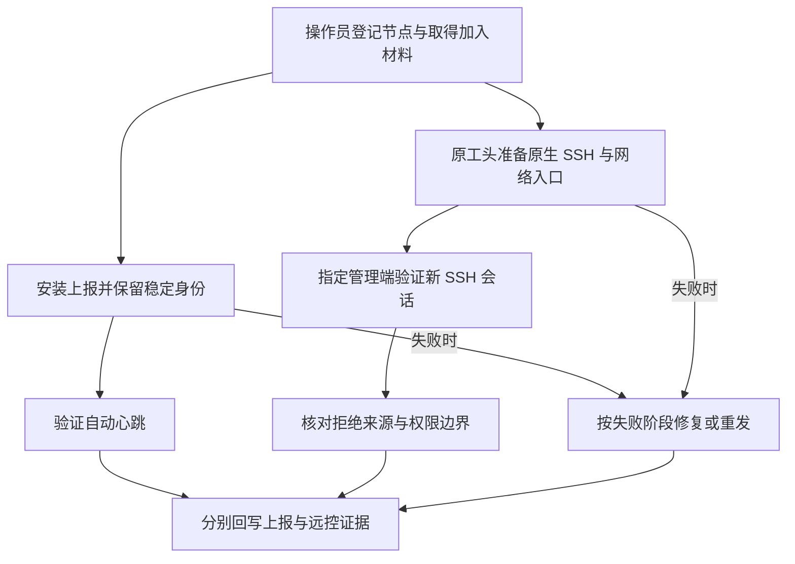

# 纳管体验、Access SSO 与原生远控就绪研究

| 字段 | 值 |
| --- | --- |
| 核对日期 | 2026-11-18（Asia/Shanghai） |
| 性质 | `DERIVED / DECISION_SUPPORT`；本轮研究与提案整合，不是已实现功能或新 ADR |
| 源码基线 | [`ce645aacde8caa72b866bb127a05c746323f8d1f`](https://github.com/youling/ghostfleet/tree/ce645aacde8caa72b866bb127a05c746323f8d1f) |
| 工作手册基线 | [ai-use `9c0263beaaea37efc8c161bda071a07c263f93a8`](https://github.com/youling/ai-use/tree/9c0263beaaea37efc8c161bda071a07c263f93a8) |
| 当前产品边界 | [ADR004](../adr/004-lightweight-enrollment-presence.md)；[主干工单 #11](https://github.com/youling/ghostfleet/issues/11) |
| 证据等级 | 源码已检查、官方文档已核对；已有现场回执仅按其时间和范围复用；本轮没有新增生产部署或 SSH 实测 |
| 详细研究 | [Access 身份与会话](ACCESS_SSO_RECON_2026-11-18.md)；[一次性加入与 SSH 就绪](JOIN_REMOTE_READY_RESEARCH_2026-11-18.md) |

## 1. 本轮结论

支持工头提出的三个体验目标：减少加入参数搬运、让纳管流程覆盖远控准备、让已通过 Access 的操作者免粘贴第二个 token。实现应继续使用现有 Worker、DO、节点身份及原生 SSH，不引入常驻命令 Agent、任务队列、另一套账户系统或新的状态数据库。

| 现场提案 | 架构取舍 | 当前状态与下一步 |
| --- | --- | --- |
| 一条命令加入 | 优先减少复制次数，保留已验证的安装器、短码和同节点修复；若后续取消短码，使用现有票据中的高熵、限时、单次 capability。签名并不能替代消费和撤销状态 | v1 仍为票据参数加交互短码；完整 bearer join 尚未实现。先做一次复制的界面/回执改进，再决定是否改变票据协议 |
| 纳管即远控 | 接受“一个流程走到可远控”的目标，设计为可恢复的分阶段操作。主机、公钥、provider 路由和 DO 无法假装成为一个原子事务 | 当前 reporter 不配置 SSH。可选的首次公钥准备由已有权限的现场安装/运维步骤承担；最后必须由指定管理端建立新 SSH 会话 |
| Access JWT 单点直通 | 复用 Access 浏览器会话；后端验 JWT 并映射既有 Operator/Read 角色，避免浏览器保存长寿命 Operator token | 优先的后续源码增量。当前仍需要应用 bearer；本轮只给出实现约束和验收候选，没有切换生产鉴权 |

这些候选可以在 #11 内按具体增量推进，不需新建三个父工单，也不把未实现的体验优化变成当前 M2/M3/M4 交付的额外前置条件。

## 2. 已有现场事实应如何吸收

[三节点回执](https://github.com/youling/ghostfleet/issues/11#issuecomment-6962898014)证明当次窗口的独立身份、安装与自动心跳；[第三节点原生直连回执](https://github.com/youling/ghostfleet/issues/11#issuecomment-6963582377)增加该路径的正向观测。它们不能替代其它路径、拒绝来源或恢复测试。

[Cloudflare 分层排障](https://github.com/youling/ghostfleet/issues/11#issuecomment-6962547549)已消除“客户端没有 cloudflared”的旧判断。当前可见故障层是 DNS NXDOMAIN；这不足以单独证明控制台里没有配置 route。下一步由原工头回读 DNS/zone、Tunnel 与 Published Application route 的实际对象、服务类型和 Access 策略，再决定最小修复。连接器 ready 和经其它路径 SSH 成功不能代填 Cloudflare 路径验收。

公开文档只保留脱敏结论。真实主机、域名、节点 ID、provider 定位符、密钥位置和原始日志继续由原实例工单承载。架构师在对话和 GitHub 完成源码、研究和审查；原工头在其已授权的主要现场自行编排机器子任务。换设备接班从 #3 → #11 → 原现场回执继续，不依赖某个聊天窗口或临时目录。

## 3. 优先增量：Access 会话直通

### 3.1 验证发生在后端

`Cf-Access-Jwt-Assertion` 是 Access 转给 origin 的请求头。页面不能从一次导航响应中把它“读出来再当 Operator token”。后端应根据部署方固定的 issuer、audience 和 JWKS 来源校验签名、算法与时间约束，再将经过验证的身份映射到现有角色。[Cloudflare 官方验证说明](https://developers.cloudflare.com/cloudflare-one/access-controls/applications/http-apps/authorization-cookie/validating-json/)给出了标准库验证路径；本轮没有引入依赖或手写验签器。

Workers 新的 `ctx.access` 能减少某些部署的手工验证，但[官方限制](https://developers.cloudflare.com/workers/configuration/cloudflare-access/)明确说明：Static Assets 内部 router 不把该对象传给用户 Worker，Service Binding 也不会自动传播调用者的上下文。当前项目配置了 Static Assets，不能仅增加 `ctx.access` 判断就宣布完成，也不为此拆成两个 Worker。后续按当前结构验证 assertion，并明确 Worker 到 DO 的可信边界。

### 3.2 会话方便，不降低角色与请求约束

建议用现有同源 `/v0/access` 返回已验证身份、现有角色和能力；前端采用显式 Access 模式，不再发送空 Bearer。角色映射默认拒绝：通过 Access 只代表应用准入，不能自动获得写权限。外部身份与本地角色的配置须明确，不能依赖可能被截断的 groups 或假设 service token 等同人类身份。

Cookie 会话会自动随请求发送，因此写请求要单独设计 CSRF 检查；当前为 bearer 兼容而容许缺失 Origin 的路径，不能原样继承到 Cookie 写入。使用精确同源证明，拒绝跨站、null Origin 及不满足所选防护模式的写入，保留 JSON 请求约束。显式携带但无效的 Bearer 不应悄悄回退为 Cookie 成功。详细限制与 OWASP 来源见 [SSO 研究](ACCESS_SSO_RECON_2026-11-18.md)。

会话过期时，AJAX 通过 Cloudflare 文档建议的 `X-Requested-With: XMLHttpRequest` 获得可处理的 401，界面引导重新登录；不自动重放结果未知的 POST。Access 的全局退出可能影响其它 Access 应用会话，不能直接把它包装成“只退出这个面板”。

仍保持两个精确 HTTPS origin。panel 使用 Access；node origin 的注册/心跳继续使用现有机器凭据。为整个 Worker 的所有域名打开统一 Access 保护，可能拦住节点入口，必须用原有双 origin 的正负测试检查这一边界。

### 3.3 下个 PR 的实际范围

一个可独立交付的候选 PR 可以只包含后端 Access 验证、既有角色映射、浏览器模式和对应测试，不包含 join 协议或 SSH 配置。先覆盖正确/错误 issuer 与 audience、过期/未生效 token、未知角色、只读写拒绝、CSRF、双 origin、Worker/DO 边界及 JWKS 故障。其生产启用由原实例 owner 在既有范围内完成实际配置与验收。

## 4. 一次性加入：先减少搬运，再改变凭据形态

源码已有稳定 node_uid、短时票据、8 位短码、每票据五次失败锁定、同一 DO 中事务消费，以及只保存摘要的上报凭据。安装器成功后已经写入 node_uid；现场反复复制 UID 的部分应优先查界面和交接胶水，不再让用户重新输入系统已经掌握的值。

现有 Python 安装器需要可交互的 stdin 与 getpass。直接把脚本接在 `curl … | bash` 后并不能保持这一输入模型，也不自动保证来源和版本。保持固定字节摘要校验，以单次复制准备参数、下载固定安装器并进入交互流程，是比换一套安装栈更小的第一步。

若之后选择完整 bearer join，应在已有票据模型中实现高熵、短 TTL、单次消费、重发替代和结果未知后的恢复。命令行、剪贴板、shell history、argv 和日志都可能暴露完整 capability；限时只缩短窗口，不等于没有泄露。不要把完整凭据放在查询字符串里。根据实际操作模式选择交互、文件或 FD，不增加没有必要的用户步骤。

[Workers Rate Limiting](https://developers.cloudflare.com/workers/runtime-apis/bindings/rate-limit/)按 Cloudflare location 计数且允许近似行为，不能承诺“全球严格五次失败”。严格的每票据失败次数和一次性消费继续留在同一个 DO；边缘限流只作为抗容量滥用的附加措施。现有十分钟有效期与五次失败锁定，也不应被写成另有一套已实现的“锁十分钟后自动重试”协议。

重试分两类：claim 结果未知时，重发同一 node 的票据，避免复制身份；本地凭据已保存、systemd 安装中断时，使用已有 repair，而不是再次 claim。完整源码映射和并发/恢复验收候选见 [加入研究](JOIN_REMOTE_READY_RESEARCH_2026-11-18.md)。

## 5. “一个流程完成”应是可恢复序列

下面是 `PROPOSED / DERIVED` 的体验流程，不是当前组件图，也不表示自动公钥配置已经实现。依据是本报告的三项取舍、ADR004 和原生传输验收矩阵。

安装/运维阶段可在已有机器授权内选择注入指定运维公钥；管理私钥不下发，保留已有 authorized_keys 内容、选项、权限和并发修改。仅按注释或文件名判断重复不可靠，需核对实际 key type 与 key blob。原生 ssh-copy-id 可复用，但它依赖初始认证通道，也不负责 provider 路由或主机信任。

上报某个 IP/hostname 只说明发现了 locator，不证明从指定管理端可达，更不证明 SSH host key 可信。主机身份应通过已有可信渠道核对，ssh-keyscan 单独使用不能建立信任。验收要记录新会话的实际来源、目标用户、路径、主机身份与时间；复用 ControlMaster 的旧连接不能冒充新的网络认证。新端点若进入协议，应显式定义允许字段，不能把任意 ProxyCommand 当作节点数据执行。

不要让周期 reporter 持有配置 SSH/provider 的权限。重复修复不应覆盖另一条已工作的 SSH 通道，也不因某一步失败而整机清空后重装。阶段回执足以表达部分成功，不需引入另一套节点生命周期。

## 6. 本轮“穷尽”范围、复用和停止条件

采用 MIXED 侦察：复用 [2026-11-12 的 42 个仓库历史基线](https://github.com/youling/ghostfleet/blob/0cbb9c17bdd298634e4ccebf2c1a9c50d9f09fe1/docs/research/REUSE_RECONNAISSANCE_2026-11-12.md)、[11 月 14 日传输侦察](TRANSPORT_RECONNAISSANCE_2026-11-14.md)和 [11 月 17 日现场增量](M3_FIELD_VALIDATION_DELTA_2026-11-17.md)，本轮重新检查影响三个提案的源码、官方契约、失败模式与近期发布。没有把所有 42 个仓库重新测试一遍，也不声称穷尽互联网。

| 决策问题 | 本轮处理与来源 |
| --- | --- |
| Access assertion 在哪里取得和验证 | origin 请求头、固定 issuer/aud/JWKS；SSO 研究 S1/S2 |
| 新 ctx.access 能否直接用于当前 Worker | Static Assets/Service Binding 限制；SSO 研究 S2 |
| Access 准入如何映射 Operator/Read | 显式身份映射、缺少可信角色则拒绝；SSO 研究 S3 |
| 刷新、过期、退出、CSRF 怎样工作 | Cookie/401/同源防护，未知结果写操作不重放；SSO 研究 S4–S7 |
| 两 origin 与 DO 是否被绕过 | 保持现有机器入口和重复鉴权边界；SSO 研究源码表及验收矩阵 |
| 单行加入要不要新签名平台 | 复用高熵票据与 DO 状态；加入研究的最小方案 |
| 失败计数和并发消费放哪里 | DO 的严格票据状态；edge 限流不提供全局严格性 |
| 安装器与重试能否照搬管道命令 | 交互 stdin、固定摘要、同节点 reissue 与 repair 分开 |
| Tailscale 的经验能否复用 | 一次性引导凭据与后续节点身份分离；不混同报告凭据和远控权限 |
| Headscale 的经验能否复用 | 默认单用/短时 preauth 的易用性；无需为此迁移控制面 |
| Teleport 的经验能否复用 | 绑定密钥持有证明和重加入恢复；当前三节点不直接增加相应平台 |
| OpenSSH 工具怎样减少手工操作 | 明确公钥、保留已有配置、可信 host key 和全新会话 |
| Smallstep SSH CA 是否必要 | 短寿命证书是规模化备选；当前没有足够需求支撑新 CA/IdP 运行负担 |
| Cloudflare 的近期变化有什么价值 | passkeys 可改善首次登录；service-token 泄露处理继续复用既有策略 |
| 传输工具的新版本是否改变当下工作 | 核对适用条件，更新诊断知识；不以“最新版”替代现场故障证据 |

停止条件是：三个提案均有当前实现差异、最小可用增量、采用/不采用理由、失败恢复、候选验收和明确现场边界。尚缺的是真实配置与生产测试，继续搜更多竞品不能代替这些证据。两个专题报告保留可追溯的官方来源和详细测试候选，后续遇到新的实际约束再增量研究。

## 7. 近期技术变化的吸收

截至本轮核对，以下官方更新与此项目有直接或潜在关系。上游发布日期不等于当前节点已安装的版本。

| 上游变化 | 采用方式 |
| --- | --- |
| [Cloudflare Access：2026-11-06 passkeys](https://developers.cloudflare.com/changelog/product/access/) | 可由 owner 选择改善首次 Access 登录；不代替本地角色映射，不作为本轮发布条件 |
| 同页 2026-11-11 service-token 泄露检测与恢复约束 | 已有 11 月 14 日研究/公开边界规则覆盖，继续复用；不把服务 token 的泄露处理机械套成应用 Operator token 的全局停机门禁 |
| [Cloudflare Tunnel URL normalization](https://developers.cloudflare.com/tunnel/platform/changelog/) | 官方 2026-11-12 条目说明 cloudflared 2026.11.0 能力及 2027-02-08 的计划默认变化；保持未来日期与当前配置分开，按原传输报告检查路径兼容 |
| [Tailscale v1.104.7 · 2026-11-12](https://tailscale.com/changelog) | 记录其 Go/TLS 中间设备兼容性相关变更，供符合症状的连接排障使用；不是当前 DNS NXDOMAIN 的原因判定 |
| [OpenSSH 10.6p2 · 2026-11-05](https://www.openssh.org/releasenotes.html) | 复核 musl/PAM-disabled 适用条件及 scp -R 的弃用方向；先核对发行版与构建，不把版本号当作 Debian 实例存在漏洞的证据 |

这些更新不触发本轮自动升级、provider 迁移或生产重部署。新增的公开来源仅在 publication policy 中逐项允许确实引用的官方站点及 JWT 库上游仓库，不放宽实例信息与凭据边界。

## 8. 后续工作如何交接

1. **当前现场收敛**：由原工头继续 M2 Read/双 origin/撤销边界、M3 repair 与中断恢复、M4 独立节点与各路径的剩余实测；复用适用旧证据。CF 从已定位的 DNS 层开始，机器子任务仍由工头自行编排。
2. **源码增量**：优先 SSO；加入界面的一次复制可独立推进；完整 bearer join 和可选 SSH 配置须先在对应 PR 明确协议/权限与恢复，不能在文档合并后宣称已上线。
3. **工单治理**：#3 是架构师入口，#11 是当前产品和交付主干，#36 承载原生兼容/恢复，#64 承载拓扑与密钥职责，#69 由原 owner 完成旧资源收尾。保留各自未完成的实际事项，不为减少数量而关闭。
4. **证据口径**：源码合并、CI、部署回读、心跳和特定路径实测分别报告；普通源码合并按现有委托完成，现场权限按原 owner 和既有范围执行。推荐的凭据卫生措施不自动升格为新的全局阻塞条件。

## English summary

This is dated decision support against the exact source revision above, not shipped SSO, bearer join, or automatic SSH provisioning. Reuse the existing Worker, DO, node identity and native SSH. Prefer server-validated Access sessions with explicit existing-role mapping; the current Static Assets deployment cannot assume that ctx.access reaches the user Worker. Preserve cookie-specific CSRF checks and the separate machine origin.

Reduce copy steps before replacing the current ticket/code protocol. Keep strict consumption and failure state in the DO; edge rate limiting is not globally exact. Treat enrollment plus remote access as one recoverable workflow with separate evidence, never as an atomic cross-provider transaction. The existing foreman remains the only machine coordinator, with GitHub receipts enabling handoff across devices.

The research reuses the prior broad comparison and refreshes decision-relevant primary sources. Current releases inform conditional diagnostics and future changes; they do not establish that a particular instance is affected, upgraded or accepted.
