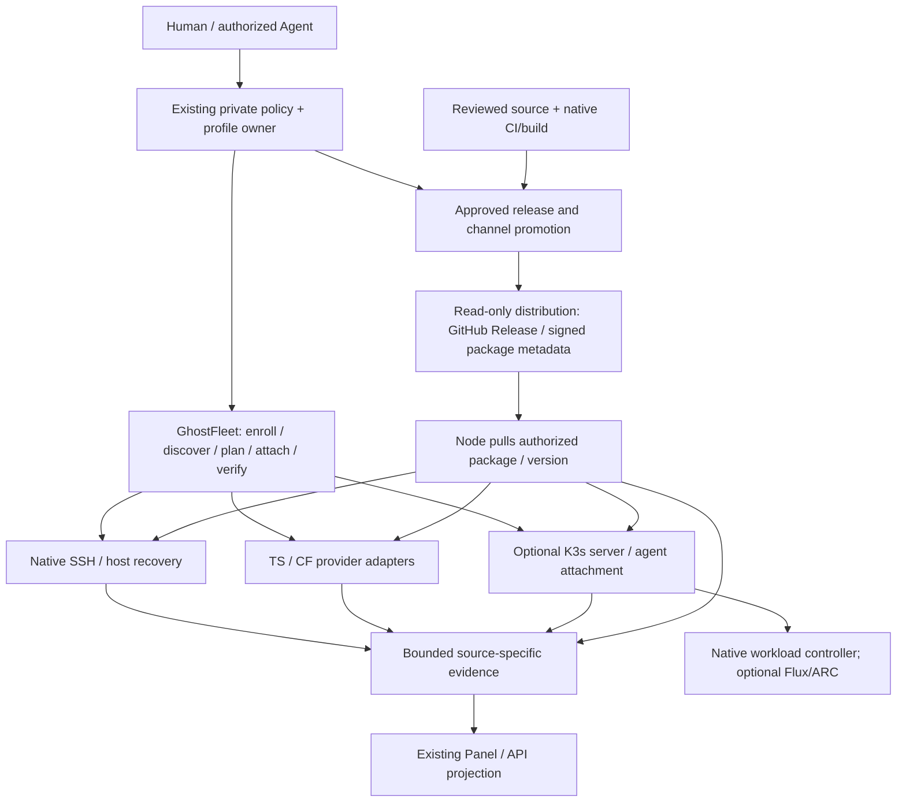

# GhostFleet 下一代架构候选：薄编排、非对称零信任、版本化 Pull 更新

## 1. 决策缘起与兼容边界

Human 要求一次有计划的较大重构：统一 TS/CF/SSH/K3s 可选纳管、复用原生健康观测、把不可信节点隔离设计在前、所有节点与产品拥有可追溯版本、节点自行周期性拉取并更新获准软件。此前 [企业设施研究](https://github.com/youling/ghostfleet/issues/11#issuecomment-7192430009) 和 [可选计算接缝](https://github.com/youling/ghostfleet/issues/11#issuecomment-7192302399) 已完成方向研究；与 [#446](https://github.com/youling/ai-hub/pull/446) exact eaafc514 的领域会签收敛，不重做全域研究。

当前基线 main d24138597fea41c74400f741ddd9634b40d8a7e8：package.json 已有 0.2.0-dev，scripts/heartbeat.py VERSION='1'；heartbeat/v1 是 4KiB 严格独立上报，现有 install manifest 只保留文件摘要。scripts/build-presence.mjs 已产生固定摘要的安装制品和 installer.json。PRESENCE 的 repair 使用本地脚本，不是升级；旧升级会走同 UID 重发/replace，可能暂时使旧报告失效。ADR006 的 provider-shadow.js 已有离线事实投影，真实 shadow 对照仍待验收。#135 exact 99d3d726 是原 ADR007 集成候选，仍 Draft/HOLD；#64 的 A09 FAIL/策略证据缺口未关闭；私有 P0 非 root 生产力接入按原 Work 继续。当前部署的产品版本不能从 package.json 推定，未知按 UNKNOWN，不补造历史稳定版。

提议目标 v0.3.0（暂定；不是已存在的 tag/release）。本文件是后续版本设计候选，不改 main/现行 ADR/生产、旧候选或已授权路径，不授予签发、权限、网络、主机安装、发布与 merge authority。不把 K3s/Flux/ARC 变成原 P0 或 ADR007 FULLY_MANAGED 的一律前置，不把新逻辑塞入 reporter-only 包。#135 继续原缺口修复，下一代只在独立分支实验，后续从真实受审基线消费，不重复搬运或覆盖现役私有 Worker 发布线。

## 2. 最小产品边界与目标图

GhostFleet 是薄的节点生命周期编排、原生能力绑定、状态投影、版本分发协调入口。OpenSSH、TS、CF、systemd、K3s、APT/原生更新工具各自执行其原生职责；ai-hub/实例 owner 持有实际节点准入、角色、信任域、Provider/cluster 绑定、Work、权限、Secret、生产发布与撤销。assets 或用户现有资产台账仍拥有物理资产。GhostFleet 不造 SSH server、调度器、常驻命令 agent、新通用权限引擎、独立 CI/任务队列或第二个节点/集群账本。K3s 是可选 backend；无 K3s 的机器仍可完全纳管。非 Debian/OMV/Windows/Android 各按现有受支持边界，不能强行装相同包或改变 appliance 存储。

箭头是逻辑关系，不代表网络互通或默认授权。构建/签名/晋升、主机管理、观测、计算与工作负载各有 authority，互不隐式晋升。使用现有 Worker/DO 身份、node_uid、既有 registry/SSOT；版本与证据扩展为兼容投影，先验证真实消费与回退，不以全新数据库/控制面替代当前状态。

## 3. 身份与不可信架构：先定失陷半径，再选集群

威胁模型：公网 MANAGED_ONLY 宿主即使 root 完全失陷、恶意 CI 运行任意代码、节点自报或本机版本/健康/日志可被伪造，仍不得据此成为 Fleet Controller、发布者或其他节点管理员。内网位置、K3s Ready、标签、加入成功、当前版本都不构成信任或授权。授权独立于网络可达；原生系统的 user/group/tag、Tunnel、cluster/Node UID、ServiceAccount、OS UID/SSH pin 只与 immutable Fleet node_uid 经受信 owner 验证后绑定，凭据独立、可撤销；同设备 repair 保留 UID，失陷替换需重新准入。Controller 多个独立主体的方向保留，各自独立凭据和目标范围；共享 root 私钥禁止。

| 来源/主体 | 允许 | 默认拒绝 |
| --- | --- | --- |
| 经授权控制者 | 对确切目标/动作的原生管理、救援、Work 调用 | 未获准目标、签名/晋升等非本职权力 |
| MANAGED_ONLY | 自身报告、获准业务出站、只读制品获取、自身必要的 K3s Agent 协调 | 访问控制节点、其他下位机管理端口、Provider admin API、NAS admin/备份删除、发布写权/签发、跨域代理/转发 |
| 普通业务/CI | 获准工作负载 API/数据/短期凭据 | 宿主 root、runtime socket、hostPath、跨域 kubeconfig、发布 signer、全局 GitHub/Provider token |
| 更新分发源 | 提供有受信发布证据的字节与版本元数据 | 通过任意脚本、metadata/config 或节点自报改变信任根/角色/网络权限 |
| 受信发布 owner | 固定制品审核与 channel promotion；可撤销/恢复 | 将签名私钥或全局管理凭据发至普通节点、CI 任务或普通业务容器 |

允许必要 TCP/TLS 响应、节点到指定 update/provider/cluster API 的请求；不是物理单向闸。实际 policy default-deny、定向 TS grants/ACL、CF Access/服务身份、独立目标 SSH 授权、provider/目标侧网络隔离和 Kubernetes RBAC/Node authorizer/admission 分层执行。不能把失陷节点可改的本地 firewall 或单层 NetworkPolicy 当唯一防线。#64 A09 当前 FAIL_ALLOW_ALL 必须由私有 owner 沿现行 Work 修复真实受影响路径；保留宽泛 allow-all 再叠窄规则不成立。负例从可信端核验，覆盖 LAN/TS/CF/公网 IPv6、代理/转发、旧会话/旧凭据、节点数据/输出伪造、错误 identity/过期 policy。隔离测试用可丢弃节点与合成秘密，不做生产攻击演练。

K3s 控制域按真实信任半径选择，不按机器名称/上位机下位机机械拆分。初始实验分离低信任公网和任意代码 CI 与核心管理/数据/发布信任域。独立 agent bootstrap 准入、secure token CA pin；Server token 与默认 Agent token 相同的危险默认值显式纠正。仅向节点交付自己的有界 token，不交 server token/cluster-admin kubeconfig；bootstrap token TTL 不等于单节点/一次性绑定，需私有准入和可信侧限制。Kubelet 能读自身调度 Pod 所需秘密；不在低信任宿主调度高信任工作负载。删除 join token、cordon/drain 或删除 Node 不自动撤销已有证书/凭据；真实撤销由外部可信端切断网络/身份/准入，必要时按 owner 轮换/替换并核在途任务。共享集群负例不通过时用独立域或原生运行。集群 API/quorum 不可用时原生管理、签名、授权恢复仍可用；不依赖待管理集群作为唯一恢复根。K3s/Flux/ARC 都不持有无界跨域权限。Tailscale API proxy/WIF 是可选身份桥，RBAC 与 Work scope 仍分别授权；实际 issuer、audience、subject/tag 权限待证。

## 4. 健康、事实与版本投影：Provider-first 扩展而非第二监控

复用 ADR006 provider-shadow 概念和现有面板。TS device online/lastSeen 与版本（网络事实）、CF Tunnel/connector health（到 Edge 事实）、K8s Node conditions/Lease/Pod probes（集群/工作负载事实）、systemd/native OS（本机状态）、实际认证 SSH/DCR probe（管理/作业可用性）、版本/升级回执分列。每项含 verified node binding、来源、观测时刻/接收时刻、范围/有效期、CURRENT/STALE/UNKNOWN/CONFLICT；缺失不等于 OFFLINE，Node Ready/Pod Ready/CF Healthy 不等于宿主救援成功、真实 OS 安全、Job admission 或业务可信。节点自报与可信侧独立探测有不同证据等级；外部成功握手也不是对已失陷 root 的完整 attestation。

不修改 heartbeat/v1 的严格形状来偷塞版本或 Provider 字段。先使用 v1 现有字段、installer metadata 与外部 API / 只读证据采集，建立并行兼容 projection；如需新 schema，独立版本/显式协商，旧客户端、旧 DO snapshot、未知字段/未知版本均有兼容/拒绝测试。先完成 ADR006 真实 shadow 对照：覆盖 TS online 但 SSH deny、CF Edge healthy/origin down、K8s Lease stale、节点非 K8s、控制面失联、伪造/过期/冲突版本、system/user manager not_found。按已定有界采样窗口评估 coverage/latency/API 成本/漏报和独立救援。只有充分原生观测替代的节点可进入 provider-only 模式；其余保留最低成本 oneshot/timer 与版本回执。未验收不降低旧心跳、不直接删除 reporter，不部署新常驻采集 agent。状态投影不触发任意 root 自愈；只消费已有授权的确定性恢复动作。

## 5. 版本模型与发布晋升

采用 SemVer 产品版本；schema/protocol 版本独立。版本是不可变制品身份的一部分，不是权限或节点身份。暂定下一代目标 0.3.0；实际每次发布绑定唯一 tag/commit 与 artifact digest。开发构建可为 0.3.0-dev.<build>、alpha/rc；生产晋升推荐用正式版本号的同一固定字节先投 canary，再晋升 stable，禁止将不同字节覆写同版本；若修改则新版本/新摘要。release channel 是 owner 控制的可更新选择，不由 SemVer 最大值、GitHub Latest/pre-release 标签或节点自选决定。

| 事实 | 必需含义 |
| --- | --- |
| product_release | GhostFleet 源码/发行版本 + exact Git commit/tag + manifest/digest |
| control_plane | 实际部署 Worker 版本 ID、source revision、支持协议范围；与私有 DCR Worker 的 runtime/policy 版本分开 |
| desired | 实例 owner 指定 profile/channel/目标 release 与 config/policy revision；不让低信任节点选择自己的权限 |
| installed | 包管理器/本地受信安装记录中的版本/平台 artifact digest、profile/config revision |
| observed_runtime | 实际运行或最近一次 reporter/oneshot 执行版本、观测来源/时刻、启动/健康结果；未观察 UNKNOWN |
| components | TS、CF、SSH/OS、K3s 等原生版本、适配状态/所有权；各自独立版本，不强行同号 |
| update_receipt | 原/目标版本、结果/原因、最后检查和成功时刻、回退及 pending-restart/needs-review；节点自报仍标来源 |

UI 将 desired/installed/observed 对照，显示 CURRENT/UPDATE_AVAILABLE/DEFERRED/FAILED/STALE/UNKNOWN 等可解释状态（名称暂定，不另建全局状态机）。历史节点先只读盘点，legacy/unverified 与已知稳定版分开；可见版本不证明完整性。兼容矩阵必须覆盖旧 client→新 server、新 client→旧 server 的受支持范围、配置/数据迁移、协议上下限、旧制品和故障回退；先发布可读兼容的 server，再 canary 客户端，再逐步迁移。数据向后不兼容的版本不能假装只回退二进制即可；保留独立恢复点。

## 6. Pull 自动升级：原生更新优先，签名、渠道、权限三者分离

GitHub Releases/Packages 用作不可变分发和版本记录，优先核验 repo 能否启用 immutable release 与 attestation。已发不可变资产/tag 仍不能证明选中的 Latest 是 Owner 认可目标（该标记可变），attestation 也不等于生产批准。公开节点读公开软件无需 PAT；私有制品只给节点必要的只读/短期下载权限，不给仓库写、CI secret、provider 或签发权限。禁止从 main、浮动 latest 或任意 URL 下载并 root 执行；校验签名信任根、版本/目标平台、制品摘要/长度、元数据新鲜度和受审晋升。信任根经一次可信安装/owner 通道预置，不能从同一个尚不可信的下载响应获取；仅可信发布端签名/晋升，低信任节点/普通 CI 不能写；独立备份与授权轮换，签名/发布失陷的停止晋升、轮换、撤销、恢复须可用。

**Debian-first 选型候选**：优先把 GhostFleet 自有文件/units 包装成最小可审 .deb，采用独立 signed APT archive / Signed-By / suite 或有界目标版本选择，由现有 systemd timer 或适配的原生 unattended-upgrades 触发，仅允许 GhostFleet 自有包与明确依赖。GitHub Release 保存不可变软件制品；静态签名索引可由现有获准分发 origin 提供，不能靠每节点 gh CLI 拉整仓。签名 index、Valid-Until、pin/allowlist、明确不自动 downgrade、拒绝旧/过期/错误签名和跨平台/跨频道制品；不使用 allow-insecure/trusted=yes，不关闭日期检查。APT 原生并不等同全部 TUF attack resistance；评估当前包方案对目标版本回退、过期/冻结、镜像不一致与签名密钥轮换的实证，若需要跨平台/更强 freshness 语义，复用成熟 TUF client/metadata，不自创加密协议。二选一为同一制品的权威更新后端，不并行维护两套签名状态机。不存在的仓库/签名/工具能力只标 UNKNOWN；首验只使用合成 key 与本地测试索引。已有脚本安装转包管理时先验 manifest 与文件所有权，保留现有 node_uid、reporting token、原生 SSH/Provider 与本地配置；不重领票据，不覆盖不属于本项目或本地已改文件。

**周期**：建议每 24h + 启动补检 + 随机抖动/退避（systemd OnCalendar/Persistent/RandomizedDelaySec），由 owner 签名发布渠道/目标与 profile 决定自动安装范围。dev 仅开发环境，canary 选可恢复节点，stable 只晋升同一经验证摘要；可 pin/freeze/暂停更新与紧急安全晋升。节点断网或镜像失败保留最后可用版本，记 STALE/DEFERRED；不能声称最新/健康。无变化 no-op，不频繁重启、不自动切换 channel、不默认重启机器。更新与报告权限分离：reporter 仍 DynamicUser、无发布/安装权限；更新走原生 package manager/固定授权的短时本地服务，不开监听端口、任意命令执行、远端自授 root。构建者与推广者职责分开，避免 untrusted PR/CI 接触生产发布密钥。验证和准备阶段不停止既有服务；按真实任务/服务影响选择窗口，活动 job/未知状态保护与必要回退，严格保留上一可用制品/配置/数据；禁止无界清场。已签名的恶意旧制品、downgrade、坏时钟、低磁盘、半安装/断电、同时更新、撤销后旧回执、重试与 owner 指定回退均入实验测试。回退是受准目标/版本变化，不绕过最低安全版本或盲目重放旧策略。

组件更新 owner 唯一：
- TS 使用现有 package/updater 按实际安装方式和 approved channel；CF package/native service restart 按恢复能力安排，不在同一时刻升级唯一两条管理链路。保留独立 SSH/救援。
- K3s Server 先逐台再 Agent，遵守 skew 和 minor upgrade 路径；不能由每台节点独立追 latest。择优用官方 System Upgrade Controller + 精确 Plan/版本及并发控制，或已授权 native host coordinator；Plan 是高特权宿主操作，普通 workload/CI 无权编写，Cluster API 失效时独立救援。不得两者争写。K3s datastore/backup 与 rollback 独立处理，不能将普通二进制降级当可用恢复。
- Flux（获准后）只协调业务目标状态，release/promotion 写权属生产授权；不直接接管主机更新、K3s 管理权限或 NAS。Worker/DO 控制面由现有受信发布 owner 部署并读回 actual provider version，节点 pull 不部署控制面。
- 平台不支持时报告 NOT_SUPPORTED，沿其原生安装/更新方式。不为统一而新造 Windows/Android 常驻 root agent。

## 7. 施工顺序与退出条件

| 阶段 | 主要交付与验收 |
| --- | --- |
| M0 版本化合同与精确基线 | 对现有 #135/ADR004/006/007/#64、#446、私有 release lineage 与安装路径做 exact inventory；列可复用、应退役、未证明项。确定 package/release candidate、compatibility、authority matrix 和 profile；版本号候选不发布。M0 源码/合成测试可立即做，真实 key/部署/网络需 owner。 |
| M1 可信发布/版本投影 | 先实现固定 source→artifact→version manifest，原生签名包/渠道候选，synthetic immutable/replay/expiry/rollback/rotation tests；旧 v1 客户端兼容与版本/来源 UI。验证从旧脚本安装到新版本 no re-enroll/no secret rotation；同一摘要再 apply no-op。Public source tests + Debian isolated test（资源由 owner 授权）。 |
| M2 非对称信任 | #64 原 owner 私有 policy/identity 矩阵、受影响路径真实 deny 与救援；控制者独立授权、发布密钥/节点下载凭据分离。先合成与隔离验证；只阻断不安全的接入/晋升，不阻塞独立源码或 P0。 |
| M3 原生自动纳管与 K3s | 优先复用现有 ADR007 stage；先 TS/CF/SSH discovery/adopt-existing，再可选 K3s config/secure join，先 1 Server+1 Agent 隔离 Debian 环境，1GiB/512MiB Agent 的整机峰值；真实 cluster+Node identity、有效 RBAC、失败恢复/撤销、断链与独立救援。Native installer 与 k3s-ansible 对照择一，未获准不碰现役业务。 |
| M4 健康精简与更新演练 | ADR006 shadow 对照加 K8s Lease/Node/Pod/外部 SSH，按节点 coverage 决定 reporter 保留/降级。独立测试 bad signature/dirty HEAD/expired metadata/旧版本、failed install、重启中断、channel promotion/pin、跨节点权限拒绝。至少两个版本之间真实重复 pull、no-op、故障回退、保留 UID 与任务结果。 |
| M5 发布/迁移与退役 | 已受审固定版本、兼容控制面、单个可恢复 canary → 验收 → 同摘要 stable、小批次渐进迁移；控制者不一起升级、不覆盖现役私有审批发布线。逐项报告实际安装/运行/目标版本、消费者 DCR 验收、节省人/Agent 步数、常驻进程/资源/运维成本与具名退役模块。K3s/Flux/ARC 分项收益成立再扩张。不存在的 CI/Host 测试为 NOT_RUN，任何生产改动由 current owner 授权。 |

M1/M2 的合成实现可按独立写域并行，真实公网准入和自动安装扩大范围以前必须满足对应 trust/authority 条件；无需等整个舰队/所有 M4 才推进原 P0。#135 旧候选继续原授权修复；新版本在独立线设计，禁止同一组件/同一发布面有多个 owner 并写。验收目标是人或 AI 不再逐台安装与对齐，不是多写一个平台。保持 #11 为产品 Work、#64 为隔离证据、私有实例 owner 为实际发布/身份/凭据，其他 repo 原 owner 不变；详细实现、API/schema、迁移成本与图随受审 ADR/PR 更新，不另建平行状态账本。

## 8. 上游证据与本次裁决限制

- [Kubernetes Node Status/Lease](https://kubernetes.io/docs/reference/node/node-status/)、[Cloudflare Tunnel health](https://developers.cloudflare.com/tunnel/observability/)、[TS client versions](https://tailscale.com/docs/reference/tailscale-client-versions)、[TS automatic updates](https://tailscale.com/docs/features/client/update)。
- [TS grants](https://tailscale.com/docs/features/access-control/grants)、[K3s token](https://docs.k3s.io/cli/token)、[Node Authorization](https://kubernetes.io/docs/reference/access-authn-authz/node/)、[K3s multicloud](https://docs.k3s.io/networking/distributed-multicloud)。
- [SemVer](https://semver.org/)、[GitHub immutable releases](https://docs.github.com/en/code-security/concepts/supply-chain-security/immutable-releases)、[Debian apt-secure](https://manpages.debian.org/trixie/apt/apt-secure.8.en.html)、[sources.list Signed-By / Valid-Until](https://manpages.debian.org/trixie/apt/sources.list.5.en.html)、[TUF security](https://theupdateframework.io/docs/security/)、[systemd.timer](https://www.freedesktop.org/software/systemd/man/latest/systemd.timer.html)、[CF upgrades](https://developers.cloudflare.com/tunnel/guides/update-cloudflared/)、[K3s automated upgrades](https://docs.k3s.io/upgrades/automated)。
- [企业案例/复用研究](https://github.com/youling/ghostfleet/issues/11#issuecomment-7192430009) 继续作为前一阶段 ARCH-0；本文增量复核健康/版本/发布与信任边界。上游 documented capability 不等于本实例可用。实际 GH 设置、可签名 archive、密钥和实验环境均未创建/验证。

本次仅 DIRECT 设计候选，以 GitHub connector 和公开上游文档核对，未运行 CI/Mermaid renderer/Host 测试或修改线上。遵循 [ai-use L0](https://github.com/youling/ai-use/blob/main/AGENTS.md)、[Architect Reconnaissance](https://github.com/youling/ai-use/blob/main/docs/ARCHITECT_RECONNAISSANCE.md)、[GitHub Native First](https://github.com/youling/ai-use/blob/main/30_PROTOCOLS/GITHUB_NATIVE_FIRST.md)。按原 owner 复核后才进入实施、明确实际发布/现场授权；当前目标版号、APT-first、24h cadence 和阶段划分均为 Architect 候选设计，不是已部署或已经承诺的稳定版。
